<div align="center">


# SENTRIX

**Secret Exposure & Network Threat Response Intelligence eXchange**

> One Intelligence. Every Exposure. Total Control.

[](LICENSE)
[](https://www.python.org/downloads/)
[](docs/DEPLOYMENT.md)
[](tests/)
[](#installation)

</div>

---

## Table of contents

- [What it is](#what-it-is)
- [What SENTRIX is](#what-sentrix-is)
- [The problem it solves](#the-problem-it-solves)
- [The full-screen Command Center](#the-full-screen-command-center)
- [Screenshots](#screenshots)
- [Features](#features)
- [End-to-end finding workflow](#end-to-end-finding-workflow)
- [Installation](#installation)
- [First run and the demo roster](#first-run-and-the-demo-roster)
- [Production mode](#production-mode)
- [Configuration](#configuration)
- [Security guidelines](#security-guidelines)
- [Privacy and secret handling](#privacy-and-secret-handling)
- [Flowcharts](#flowcharts)
- [Architecture and repository layout](#architecture-and-repository-layout)
- [CLI](#cli)
- [Tests](#tests)
- [Intelligent Finding Assignment & Team Workload](#intelligent-finding-assignment--team-workload)
- [Employee Operations & Closed Findings](#employee-operations--closed-findings)
- [Accessing SENTRIX from a Kali Linux VMware VM](#accessing-sentrix-from-a-kali-linux-vmware-vm-windows-host)
- [Documentation](#documentation)
- [Licenses and attribution](#licenses-and-attribution)

---

## What it is

**SENTRIX is a self-hosted security intelligence platform for secret exposure.** It finds credentials, API keys, tokens and other sensitive values wherever a modern engineering organization leaks them — source code, git history, the developer's editor, CI pipelines, cloud functions, chat and ticketing exports, and the filesystem — then scores the risk, routes the alert to the right person, and follows the finding through remediation until a rescan verifies it is gone.

It is a **single Python application with zero required dependencies**. One process serves a JSON API and a complete dark/light, desktop-and-mobile web console. It runs fully offline on `127.0.0.1`, stores everything in one SQLite database, and never stores a raw secret.

> **A note on the name:** if you arrived looking for **“Centrix”**, this is the same product — **SENTRIX** is the name used throughout this repository. Both refer to the Secret Exposure & Network Threat Response Intelligence eXchange described here.

---

## What SENTRIX is

SENTRIX is five capabilities fused into one console instead of five disconnected tools:

| Layer | What it does |
| --- | --- |
| **SENTRIX Command Center** | The enterprise console: unified overview, posture analytics, intelligence prioritisation, live detection pipeline, findings workflow, alerts, reports, compliance, access management and settings. |
| **SENTRIX Intelligence Core** | A registry of **26 detectors**, Shannon-entropy scoring, format validation, environment classification, SHA-256 fingerprinting, cross-surface dedupe, allowlisting, custom rules and an explainable 0–100 risk engine. |
| **SENTRIX Connect** | Nine integrations (GitHub, GitLab, Bitbucket, Jenkins, AWS, Slack, Jira, Confluence, Postman) with honest connection states, declared permissions, sync records and per-provider finding counts. |
| **SENTRIX Exposure Center** | Attack-surface inventory, source coverage and gap analysis, investigate/remediate workflow with a full finding drawer, notes, history and checklists, plus an exception registry. |
| **SENTRIX Response** | Alert routing with quiet hours and dedupe, eleven rotation playbooks, redact/quarantine/restore, ticketing, verification rescans, a remediation board with SLAs, background jobs, schedules and reports. |

---

## The problem it solves

Secrets leak constantly — a key committed “just for a minute”, a token pasted into a ticket, an `.env` baked into a Lambda, a credential in a pre-push branch that never reaches `main`. Most teams respond with a patchwork of scanners that each see one surface, produce noisy unranked output, store the very secret they are warning about, and stop at “found it”. Nobody knows what is critical, who owns it, whether it was fixed, or whether the fix was verified.

SENTRIX addresses that whole chain:

1. **One detection core, every surface.** The same detectors and scoring run in the editor, git hooks, CI gates, cloud scans, SaaS exports and the filesystem, so a finding means the same thing everywhere.
2. **Signal instead of noise.** Entropy, format validation, environment context, dedupe and an explainable risk score turn thousands of matches into a ranked queue with reasons.
3. **No secret sprawl.** Only masked previews and SHA-256 fingerprints are persisted — never the raw value, in the database, logs, alerts or AI prompts.
4. **Ownership and accountability.** Findings are assigned, investigated with notes and history, and every state transition is audited with actor and timestamp.
5. **Closure you can prove.** Remediation actions lead to a verification rescan; compliance evidence maps controls to recorded findings and actions.

The result: a small team gets enterprise-grade exposure detection, response and audit evidence from one offline binary-free install.

---

## The full-screen Command Center

The console is designed to use the whole screen with no dead chrome: a compact top bar, a grouped sidebar, and a dense content area that scales from desktop to mobile. The default Home view (`#/home`) is a pro-style command center with live security posture, orbit intelligence visualization, top sources, outcomes, and operational metrics — all sourced from real backend data (unavailable metrics shown as N/A).

The top bar carries live status, Hubs messages, theme switch and the signed-in user's avatar. The sidebar groups views into Command Center, Detection, Attack Surface, Response, and Governance.

---

## Screenshots

> Captured locally from the current demo build. All values shown are synthetic demo data.

**Home — Command Center**

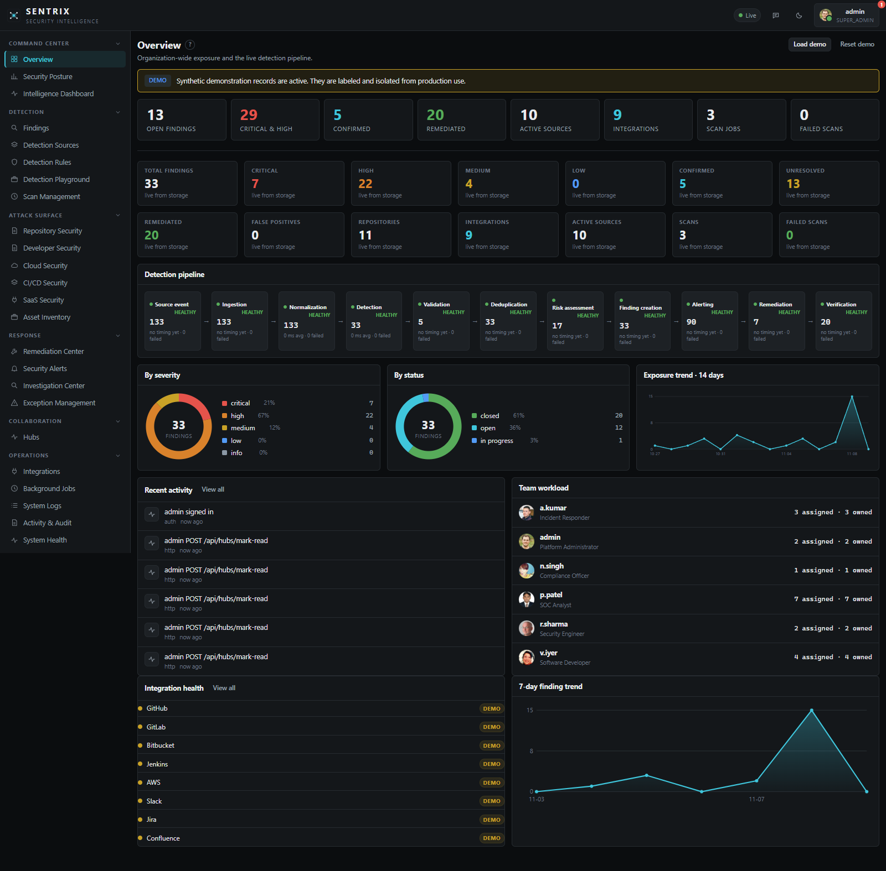

**Overview — organization-wide exposure and detection pipeline**

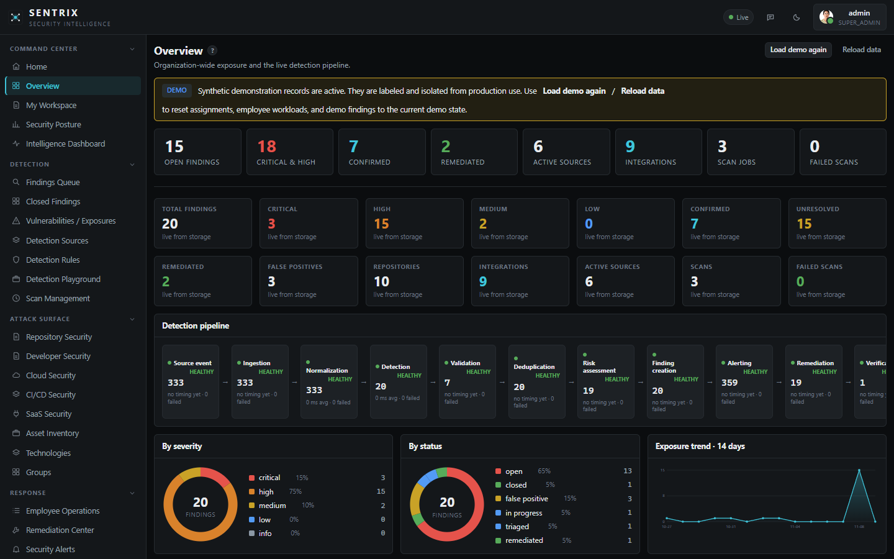

**Findings — central queue with workflow stages**

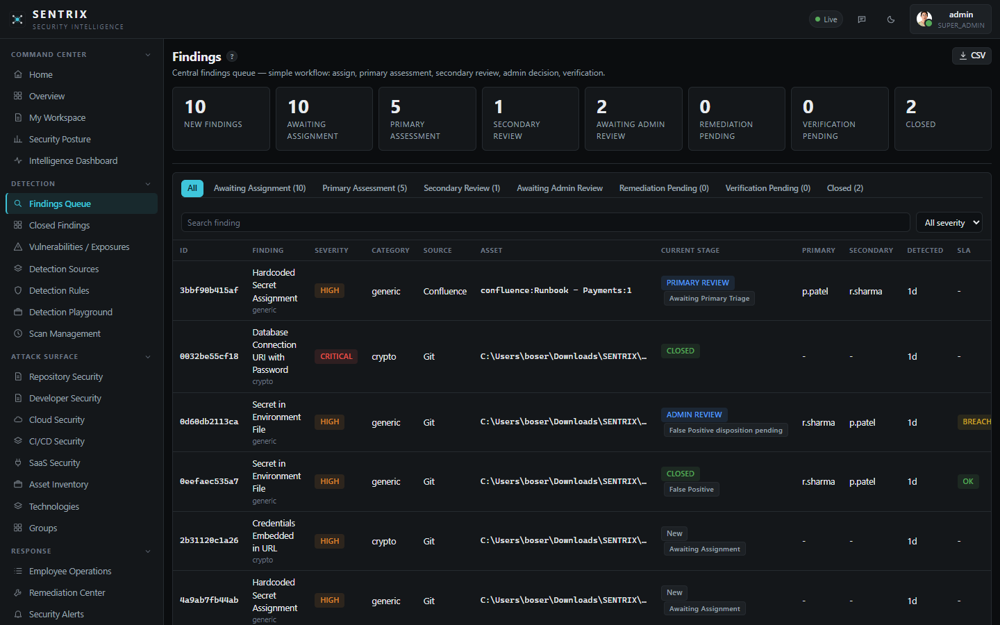

**Finding detail — workflow drawer (primary assessment)**

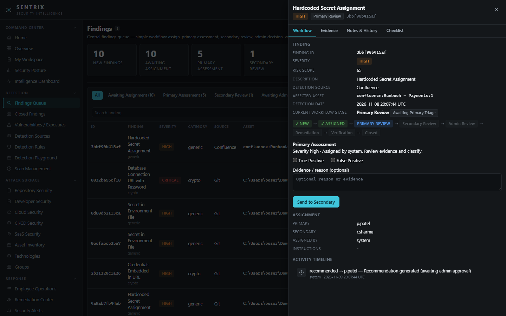

**Employee Operations — Admin command centre for team workload and controls**

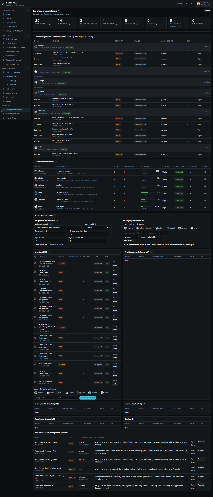

**My Workspace — Admin view (Awaiting action / in-progress remediation)**

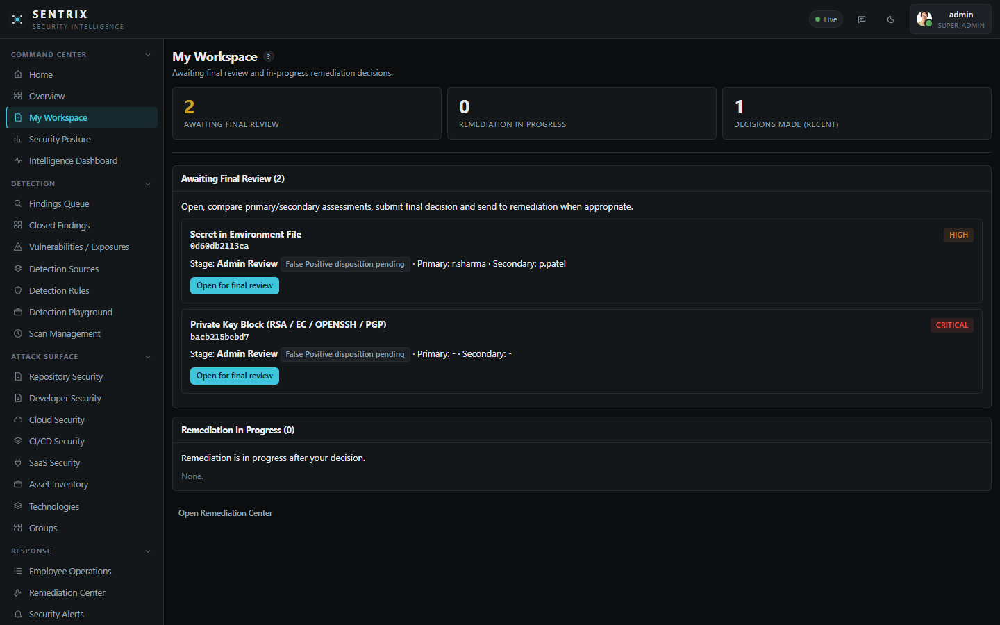

**Closed Findings — closed findings (retained)**

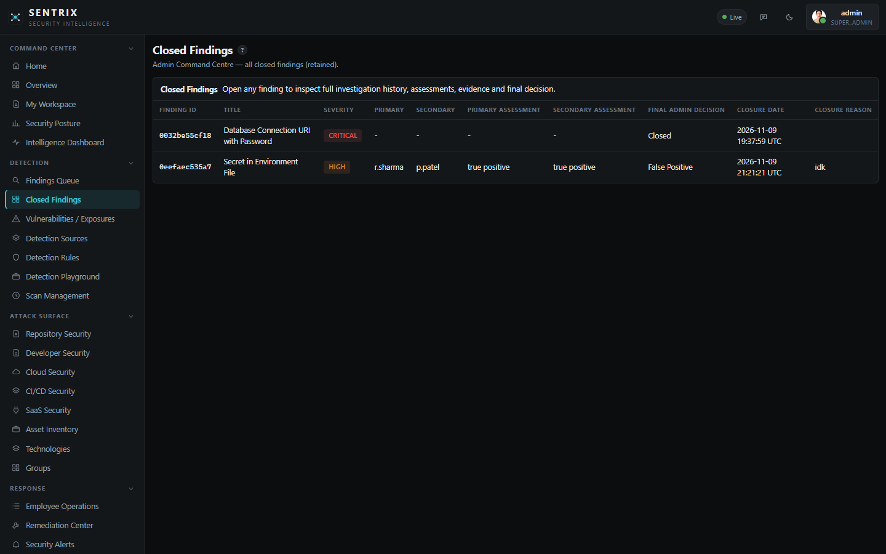

**Detection Sources — coverage and telemetry**

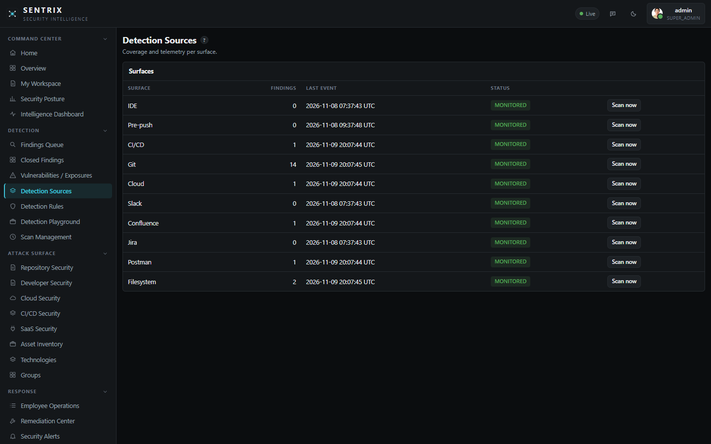

**SENTRIX Connect Integrations**

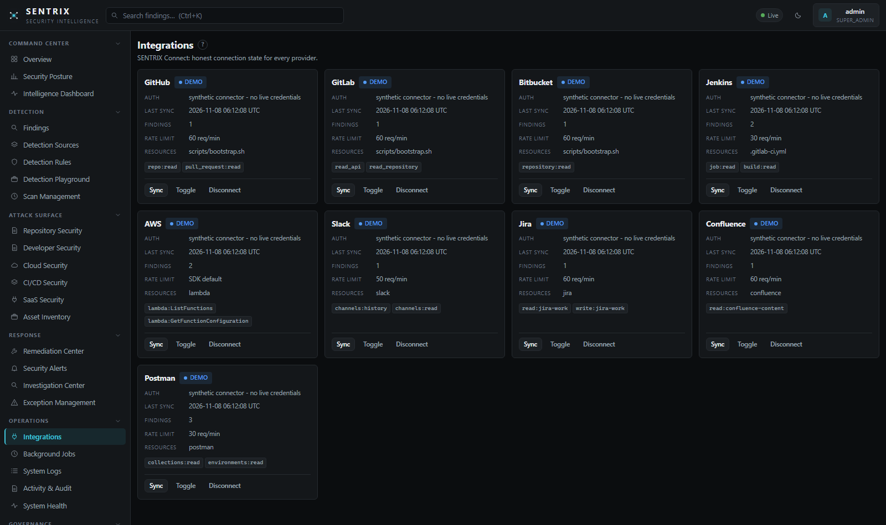

**Hubs — company chat and private DMs**

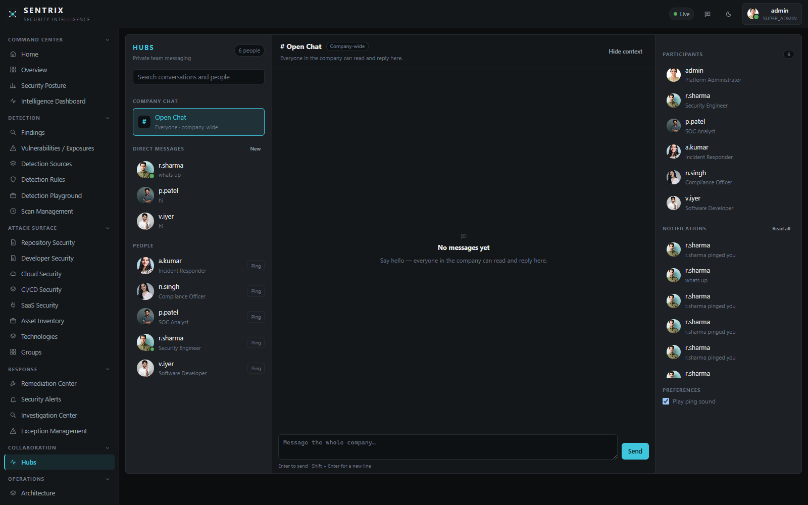

---

## Features

### Detection

- **26 detectors** across cloud, crypto, SaaS, AI and generic families, plus custom detection rules.
- **Ten surfaces:** IDE on-save, pre-commit/pre-push hooks, CI diff gates, git history, cloud Lambda code and environment, Slack, Confluence, Jira, Postman and the filesystem.
- **Explainable risk:** entropy, format validation, environment classification and context combine into a 0–100 score with per-factor justification.
- **Dedupe and allowlisting** keyed by SHA-256 fingerprint, with a reason recorded for every exception.
- **Detection Playground** to test a value or rule against the engine before shipping it.
- **Scan management** with incremental scan cache, scheduling, cancellation and two-slot job concurrency.

### Investigation and response

- **Full finding lifecycle:** `new`/`open` → `triaged` → `assigned` → `in_progress` → `remediated` → `verified` → `closed`, plus `false_positive`, `accepted_risk`, `suppressed` and `reopened`. Every transition records actor and timestamp.
- **Finding detail drawer** with provenance, masked value, risk factors, notes, history, checklist, triage and remediation actions.
- **Three-stage review workflow:** Primary assignee (True/False Positive) → Secondary reviewer (independent re-check) → Admin (final decision). Admin cannot reassign here; Admin sends true positives to **Remediation Center** and closes false positives directly.
- **Redact, quarantine and restore**, ticketing (live Jira or outbox draft), and **verification rescans** — closure is proven, never assumed.
- **Eleven rotation playbooks** with step-by-step guidance per secret type.
- **Remediation task board** with per-severity SLAs and escalation.
- **Alert routing** to console, outbox, Slack webhook and generic webhook, with rules, quiet hours, dedupe windows, retries and acknowledgement.

### Visibility and governance

- **Security posture** trends, severity mix, MTTR and age buckets.
- **Intelligence dashboard** for prioritisation across surfaces and owners.
- **Asset inventory**, source coverage and **coverage-gap analysis**.
- **Eleven report types** with download history.
- **Compliance evidence mapping** for SOC 2, ISO 27001, PCI DSS and NIST CSF (mapping, not certification).
- **Audit trail** and structured system logs with correlation fields.
- **Access management:** users, eight roles, disable, API tokens and revocations.
- **Health, metrics, backup, restore, retention purge and vacuum.**

### Collaboration

- **SENTRIX Hubs:** one company **Open Chat** channel plus private one-to-one DMs, pings with sound, notifications and presence.
- **Per-tab sessions:** each browser tab keeps its own signed-in account, so signing out in one tab does not affect another.
- **Private DMs only:** there is no administrator oversight of direct messages; they are visible to their two participants.
- **Read-only roles** are clearly told in the account and chat UI: *“This is a read-only account, so you can't send messages or pings.”*

### Platform

- **Dark and light themes**, command palette, help popovers and keyboard navigation.
- **Zero required dependencies** — Python 3.11+ standard library only. `boto3` is the single optional extra for live AWS scanning.
- **Offline by default.** No telemetry, no phone-home, no cloud account required.
- **One SQLite database** with migrations, online backup and retention controls.

## End-to-end finding workflow

SENTRIX models a secret exposure from detection through verified closure — not just a “found it” tool.

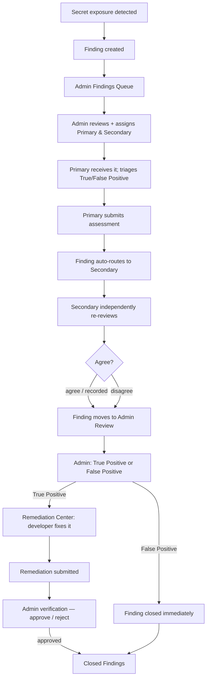

**Roles and responsibilities:**

| Stage | Who acts | Action |
| --- | --- | --- |
| Intake | SENTRIX engine | Detection, deduplication, risk scoring, `new` status |
| Admin review | `super_admin` / security admin | Review evidence, assign Primary + Secondary, send to review |
| Primary review | Primary assignee (`appsec_engineer` etc.) | Choose **True Positive** or **False Positive**, add optional notes, **Send to Secondary** |
| Secondary review | Secondary reviewer | Independently choose **True Positive** or **False Positive**, optional evidence/notes, **Send to Admin** |
| Admin decision | Admin | Compare both assessments; **True Positive → Remediation Center**; **False Positive → closed immediately** |
| Remediation | Developer / assignee | Fix exposure, submit evidence for verification |
| Verification | Admin | Approve or reject remediation; rejection sends the finding back to the remediation owner |
| Closure | System / Admin | Verified finding is marked **closed** and appears in **Closed Findings** |

**Key properties of the implemented workflow:**

- Admin assigns **both** Primary and Secondary up front.
- Primary cannot send directly to Admin — Primary → Secondary → Admin is enforced.
- Evidence and reasoning are **optional**; only the True/False classification is required.
- Admin does **not** do primary or secondary review — Admin only makes the final decision.
- True Positives land in the **Remediation Center**; False Positives are closed immediately with admin justification, both landing in **Closed Findings**.
- Every step is audited with actor, timestamp, and reason.
- Employees see only their own work (employee/self view); Admin sees all team work.

---

## Installation

### Requirements

| Requirement | Details |
| --- | --- |
| Python | **3.11 or newer** (SENTRIX uses `tomllib`) |
| Dependencies | **None required.** `boto3` is optional, only for live AWS scanning |
| Disk | ~50 MB for the application; the SQLite database grows with findings and logs |
| OS | Windows 10/11, Kali/Debian/Ubuntu, macOS, or any Python 3.11+ platform |

Verify Python:

```sh
python --version      # Windows
python3 --version     # Linux / macOS
```

### Windows 10 / 11

1. Install Python 3.11+ from [python.org](https://www.python.org/downloads/) with **“Add python.exe to PATH”** enabled.
2. From the SENTRIX folder, double-click `run.bat`, or run:

   ```bat
   run.bat
   ```

   Arguments are forwarded, e.g. `run.bat scan .` or `run.bat serve --port 8720`.

3. Optional git hooks for a repository (requires Git for Windows):

   ```bat
   cd C:\path\to\your\repo
   python C:\path\to\SENTRIX\run.py hooks install
   ```

   Or use `scripts\install-hooks.ps1 -Repo C:\path\to\your\repo`.

### Kali / Debian / Ubuntu

```sh
sudo apt update && sudo apt install -y python3 git
python3 --version       # must be 3.11+
chmod +x run.sh         # once, if needed
./run.sh
```

`scripts/setup-kali.sh` performs the same setup non-interactively.

### macOS

```sh
brew install python@3.12 git     # or use the python.org installer
python3 --version
./run.sh
```

### Any platform, explicitly

```sh
python run.py                    # Windows
python3 run.py                   # Linux / macOS
```

With no arguments SENTRIX starts the Command Center at **http://127.0.0.1:8710**. Choose another port with `--port`:

```sh
python run.py serve --port 8720
```

### Optional: editable install

Adds the `sentrix` console command (still no third-party dependencies):

```sh
python -m pip install -e .
sentrix serve
```

### Optional: live AWS scanning

```sh
python -m pip install boto3
```

Everything else works with the standard library alone.

---

## First run and the demo roster

On the very first start:

1. **Admin account.** If no users exist, `admin` (role `super_admin`) is created. The password comes from `SENTRIX_ADMIN_PASSWORD` when set; otherwise from the demo password in demo mode, or a random value written to `data/INITIAL_ADMIN_PASSWORD.txt`.
2. **Demo roster.** With `auth.demo_mode = true` and the server on loopback, five team accounts are seeded and listed on the sign-in page with one-click sign-in.
3. **Demo findings.** If the findings store is empty, synthetic findings are seeded across all ten surfaces so every view is explorable immediately.
4. **Sign in** at `http://127.0.0.1:8710`, then change the admin password.

### Demo accounts (local only)

| Account | Role | Title | Demo password |
| --- | --- | --- | --- |
| `admin` | `super_admin` | Platform Administrator | `sentrix-demo` |
| `r.sharma` | `appsec_engineer` | Security Engineer | `r.sharma-demo` |
| `p.patel` | `security_analyst` | SOC Analyst | `p.patel-demo` |
| `a.kumar` | `devsecops_engineer` | Incident Responder | `a.kumar-demo` |
| `n.singh` | `auditor` | Compliance Officer | `n.singh-demo` |
| `v.iyer` | `developer` | Software Developer | `v.iyer-demo` |

`n.singh` (auditor), `v.iyer` and `a.kumar` are **read-only** accounts: they can read every non-admin view and use Hubs, but cannot send messages or pings or perform mutations.

These credentials are **local-only**. The roster card disappears as soon as an account's password is changed, when the server binds to a non-loopback host, or when `auth.demo_mode = false`. In production mode no demo accounts are seeded and no credentials are ever displayed.

### Scripted installs

```sh
export SENTRIX_ADMIN_PASSWORD="a-strong-passphrase"    # Linux / macOS
python3 run.py serve
```

```bat
set SENTRIX_ADMIN_PASSWORD=a-strong-passphrase
run.bat
```

Delete or protect `data/INITIAL_ADMIN_PASSWORD.txt` — it is plaintext.

---

## Production mode

Put overrides in `config.local.toml` (gitignored):

```toml
[auth]
demo_mode = false
fixed_roster = false      # optional: allow your own account list

[server]
host = "127.0.0.1"        # keep loopback unless behind a TLS reverse proxy
```

Effects of `demo_mode = false`:

- No demo team accounts are seeded; the login-page roster and `GET /api/auth/demo-info` credential listing disappear.
- Integrations without configured credentials report `disconnected` instead of `demo`.
- The first-run admin password is random unless `SENTRIX_ADMIN_PASSWORD` is set.

Existing demo accounts created earlier remain in the database — disable or re-password them when converting an existing installation.

### Running as a service

Use the OS supervisor of your choice (systemd, NSSM, launchd) to run `python run.py serve` with the working directory set to the SENTRIX folder, a dedicated low-privilege user, and `data/` writable only by that user. See [docs/DEPLOYMENT.md](docs/DEPLOYMENT.md).

### Backup and restore

```sh
python run.py backup --dest backups/
```

Backups are online SQLite copies. Restore by stopping the server and replacing `data/sentrix.db`. Back up `config.local.toml` and environment secrets separately — they are not in the database.

### Upgrading

Stop the server, replace the application files (keep `data/` and `config.local.toml`), start it again. Schema migrations apply automatically and are recorded in the `migrations` table. Then run:

```sh
python run.py selftest
python -m unittest discover -s tests -v
```

---

## Accessing SENTRIX from a Kali Linux VMware VM (Windows host)

If you run SENTRIX on a **Windows host** and want to open it from a **Kali Linux virtual machine in VMware**, follow this process. It preserves the existing VMware network configuration, does **not** modify SENTRIX source code, and does **not** expose the service to public networks.

> Use this only on a trusted local/VMware network. Restrict firewall rules to the VMware virtual network and the required TCP port.

### 1. Identify IP addresses

On **Kali Linux (guest)**, find the VM IP:

```bash
ifconfig
```

On **Windows (host)**, find the VMware **VMnet8** adapter IP:

```powershell
ipconfig
```

Note the IPv4 address for **VMware Network Adapter VMnet8** (example: `192.168.x.x`). This is `WINDOWS_VMNET8_IP`.

### 2. Confirm SENTRIX is listening on Windows

Check whether the target application is listening on its localhost port (default `8710`):

```powershell
netstat -ano | findstr :8710
```

If the app is bound only to `127.0.0.1:8710`, Kali cannot reach it on the VMnet8 address until port forwarding is configured.

### 3. Configure Windows TCP port forwarding

Forward traffic from `WINDOWS_VMNET8_IP:8710` to `127.0.0.1:8710` (run **as Administrator**):

```powershell
netsh interface portproxy add v4tov4 listenaddress=WINDOWS_VMNET8_IP listenport=8710 connectaddress=127.0.0.1 connectport=8710
```

Verify:

```powershell
netsh interface portproxy show v4tov4
```

Remove later if needed:

```powershell
netsh interface portproxy delete v4tov4 listenaddress=WINDOWS_VMNET8_IP listenport=8710
```

### 4. Create a scoped Windows Firewall inbound rule

Allow TCP `8710` **only** from the VMware virtual network (Administrator). Adjust the subnet to your VMnet8 range (use the narrowest scope):

```powershell
New-NetFirewallRule -DisplayName "SENTRIX VMnet8 8710" -Direction Inbound -Action Allow -Protocol TCP -LocalPort 8710 -RemoteAddress 192.168.0.0/16
```

Do **not** use `Any` or expose the service to public networks.

### 5. Access and verify from Kali

Open in Kali:

```text
http://WINDOWS_VMNET8_IP:8710
```

Verify:

```bash
curl -v http://WINDOWS_VMNET8_IP:8710
```

If it fails, recheck VMnet8 IP, `netstat` binding, `portproxy`, firewall scope, and VMware network settings.


## Configuration

Configuration layers as **built-in defaults < `config.toml` < `config.local.toml`**. Secrets and the initial admin password come from environment variables, never from committed config. `--config ROOT` points the CLI at another project root containing `config.toml`.

| Section / key | Default | Meaning |
| --- | --- | --- |
| `server.host` | `"127.0.0.1"` | Bind address |
| `server.port` | `8710` | HTTP port (`serve --port` overrides) |
| `auth.session_hours` | `12` | Session lifetime; remember-me uses 30 days |
| `auth.login_rate_limit` | `5` | Failed logins per IP before throttling |
| `auth.fixed_roster` | `true` | Lock the workspace to the six-person demo roster |
| `auth.demo_mode` | `true` | Show demo credentials on the login page (loopback only) |
| `scan.max_file_bytes` | `1_000_000` | Largest file scanned |
| `scan.entropy_threshold` | `4.5` | Shannon entropy floor |
| `scan.fail_on` | `"high"` | Severity at which `--strict` / gates fail |
| `storage.path` | `"data/sentrix.db"` | SQLite database location |
| `alerting.channels` | `["console", "outbox"]` | Default alert fan-out |

Common environment variables:

| Variable | Purpose |
| --- | --- |
| `SENTRIX_ADMIN_PASSWORD` | Initial admin password for scripted installs |
| `SENTRIX_HOME` | Location used by hooks to find SENTRIX |
| `SLACK_WEBHOOK_URL` | Slack alert channel / polling token |
| `JIRA_URL`, `JIRA_EMAIL`, `JIRA_TOKEN` | Live Jira integration and ticketing |
| `GITHUB_TOKEN`, `GITLAB_TOKEN` | Code-host API access |
| `AWS_*` | Optional live AWS scanning via `boto3` |

See [docs/DEPLOYMENT.md](docs/DEPLOYMENT.md) for the full reference and [docs/INTEGRATIONS.md](docs/INTEGRATIONS.md) for provider setup.

---

## Security guidelines

SENTRIX is built to be operated self-hosted and conservatively. The essentials:

### Authentication

- **Passwords:** PBKDF2-HMAC-SHA256, **200,000 iterations**, random 16-byte hex salt per user; constant-time verification; minimum 10 characters; changing a password requires the current one. Hashes and salts are never returned by any API.
- **Sessions:** server-side, `HttpOnly`, `SameSite=Strict`; 12 hours by default, 30 days with remember-me; per-tab tokens keep separate accounts in separate browser tabs.
- **Rate limiting:** per-IP failed-login throttling (default 5). It is in-process memory, so put a rate-limiting proxy in front of internet-facing deployments.
- **CSRF:** origin-checked on state-changing requests.
- **API tokens:** `sxt_` bearer tokens stored only as hashes; plaintext is shown **once** at creation; revocable; named per pipeline.

### Role-based access control (RBAC)

Eight roles: `super_admin`, `security_admin`, `security_analyst`, `appsec_engineer`, `devsecops_engineer`, `developer`, `auditor`, `viewer`.

| Capability | super_admin | security_admin | security_analyst | appsec_engineer | devsecops_engineer | developer | auditor | viewer |
| --- | :-: | :-: | :-: | :-: | :-: | :-: | :-: | :-: |
| Read all non-admin API routes | yes | yes | yes | yes | yes | yes | yes | yes |
| Mutations (findings, scans, jobs, rules, remediation, reports, tuning, backup, vacuum) | yes | yes | yes | yes | yes | no | no | no |
| Logout / own password change | yes | yes | yes | yes | yes | yes | yes | yes |
| User management (`/api/users*`) | yes | yes | no | no | no | no | no | no |
| Token management (`/api/tokens*`) | yes | yes | no | no | no | no | no | no |
| Restore / import / retention purge | yes | yes | no | no | no | no | no | no |

Read-only roles see an explicit notice in Settings, Hubs, the top bar and the user menu, and content writes return `403`.

### Transport and response headers

- Default bind is `127.0.0.1:8710` over plain HTTP for loopback use. **Do not expose SENTRIX directly to the internet.** Terminate TLS at an authenticating reverse proxy, keep `SameSite=Strict` in mind, and disable demo mode first.
- Every response carries `Cache-Control: no-store`, `X-Content-Type-Options: nosniff`, `X-Frame-Options: DENY` and `Referrer-Policy: no-referrer`.
- Static serving is whitelisted (`index.html`, `app.js`, `styles.css`, `login.html`, favicon, logo, avatar images); no directory traversal or arbitrary file reads.
- **SSRF protection:** outbound requests (webhooks, integrations) are constrained; treat webhook URLs as secrets because they grant posting access to your channels.
- **Egress:** telemetry is off by default; no outbound traffic occurs unless you configure a connector.

### Audit and logging

- Append-only `audit` table: login success/failure, logout, password changes, user creation, role changes, disable/enable, token creation/revocation, backup/restore/purge, and other sensitive operations.
- Structured `system_log` with severity and correlation fields.
- Alert delivery results are persisted per alert: `sent`, `http-<code>`, `failed: <reason>`, `deferred-quiet-hours`, `dry-run`.
- Review `audit` and `system_log` (`warn`/`error`) regularly and wire `/api/system/health` and `/api/metrics` into monitoring.

### Hardening checklist

1. Set `auth.demo_mode = false` before any non-loopback exposure; verify the login roster is gone.
2. Set `SENTRIX_ADMIN_PASSWORD` for scripted installs; otherwise change the generated admin password immediately and delete `data/INITIAL_ADMIN_PASSWORD.txt`.
3. Change all demo team passwords or remove the accounts; disable unused accounts.
4. Keep the bind address on loopback or behind an authenticating TLS reverse proxy.
5. Issue least-privilege, named API tokens per pipeline; revoke retired ones; never commit tokens.
6. Store connector tokens only in environment variables; grant read-only scopes (Jira write only if ticketing is used).
7. Protect `data/` like a credential store: it holds password hashes, sessions, token hashes and quarantined originals. Restrict filesystem permissions and backup access.
8. Configure retention purge + vacuum on a schedule; export audit/log evidence before purging if required.
9. Review `audit` and `system_log` regularly; monitor health and metrics.
10. Run `python run.py selftest` and the unit suite after upgrades; verify migrations applied.

### Responsible disclosure

**Report privately.** Do not open public issues, pull requests or discussions for suspected vulnerabilities.

1. Use the repository's private vulnerability reporting channel (Security → Report a vulnerability).
2. Include affected version, component, reproduction steps using **synthetic values only**, impact assessment and any suggested fix.
3. Allow maintainers reasonable time to remediate before public disclosure. Never test with live credentials, and never paste real secrets into reports — use masked or synthetic values.

Full details: [docs/SECURITY.md](docs/SECURITY.md).

---

## Privacy and secret handling

- **Raw secrets are never persisted.** Only a masked preview (for example `AKIA********3456`) and a SHA-256 fingerprint are stored. The raw value never reaches the database, logs, alerts or AI prompts.
- **AI triage is opt-in and masked.** The default triage is a deterministic local heuristic; any GPT-compatible endpoint receives masked values only.
- **DMs are private.** Hubs direct messages are visible only to their two participants. There is no administrator oversight or admin DM reading.
- **Demo data is synthetic.** Seeded findings use fake values and are safe to explore.
- **No telemetry.** SENTRIX does not phone home.
- **Quarantine holds originals** for restore. Treat `data/quarantine/` as sensitive and protect it accordingly.
- **Avatar photos** are demo assets (see [attribution](#licenses-and-attribution)); replace them in production.

See [docs/PRIVACY.md](docs/PRIVACY.md) for the full data-handling description.

---

## Flowcharts

### Detection pipeline (11 stages)

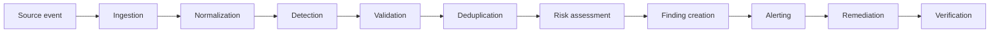

### Finding lifecycle

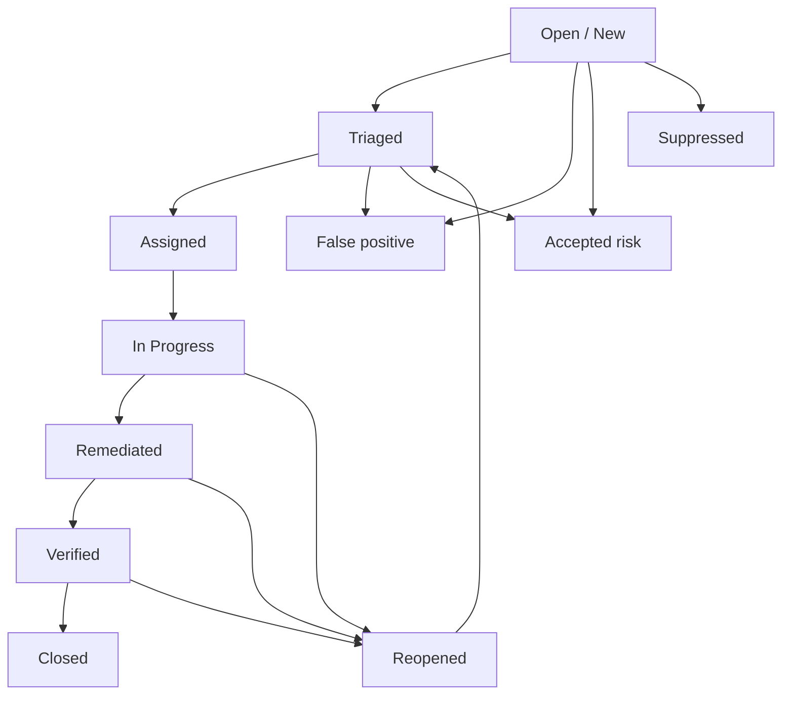

> State handling is centralized in `sentrix/core/lifecycle.py` (advisory/permissive for compatibility) and exposed via `GET /api/lifecycle`.

### Primary → Secondary → Admin review workflow

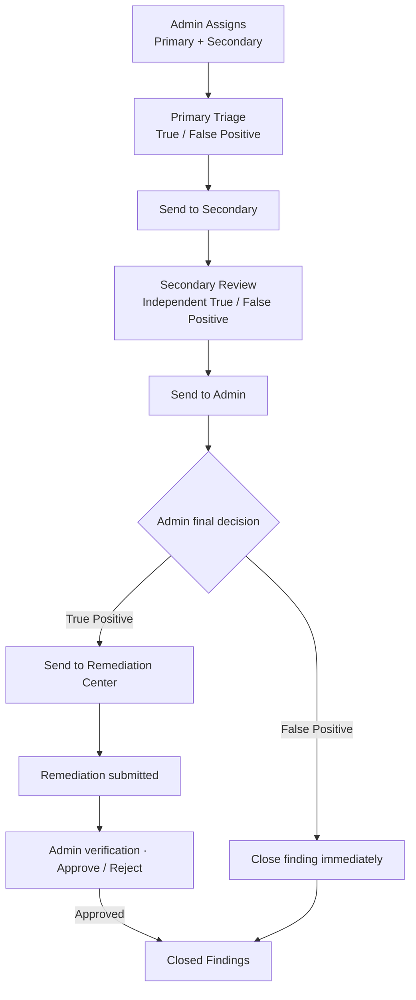

**Important properties of the implemented workflow**

- Admin chooses **both** Primary and Secondary at assignment time and cannot reassign later from the review screen.
- Primary and Secondary classifications are recorded separately; both are visible to Admin for comparison.
- Admin does **not** act as a reviewer — Admin only approves the final disposition.
- Evidence and reasoning are **optional**; only the classification matters to advance the workflow.
- True positives go to **Remediation Center** and are closed after successful verification; false positives are closed immediately.

### Scan / job execution flow

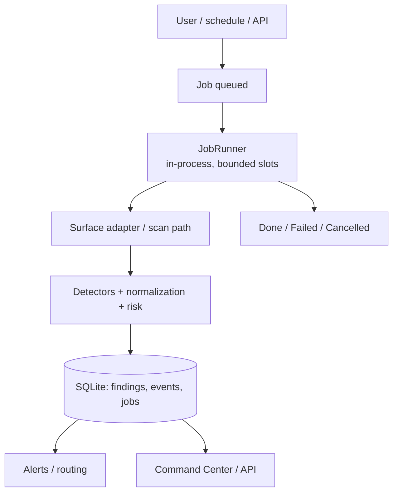


## Architecture and repository layout

SENTRIX is a **modular monolith**: one Python process, one SQLite database, clear internal boundaries that can be extracted into services later.

```text
SENTRIX/
├── run.py / run.bat / run.sh     One-click entry points
├── config.toml                   Safe defaults (override in config.local.toml)
├── Makefile / pyproject.toml     Dev targets and packaging (MIT, stdlib-only)
├── sentrix/
│   ├── server.py                 Stdlib HTTP server: JSON API + console
│   ├── auth.py                   Sessions, RBAC (8 roles), tokens, audit
│   ├── cli.py / config.py        CLI commands; layered configuration
│   ├── demo.py / watch.py        Synthetic seeding; filesystem watcher
│   ├── core/                     engine, pipeline, storage, extensions,
│   │                             jobs, risk, reports, integrations, models
│   ├── detectors/                base registry + cloud/crypto/saas/generic
│   ├── surfaces/                 ide, git, filesystem, cloud, slack,
│   │                             confluence, jira, postman
│   ├── alerting/router.py        Channels, rules, quiet hours, retries
│   ├── remediation/playbooks.py  Rotation guides and response actions
│   ├── ai/                       Heuristic + optional GPT triage
│   ├── hubs/                     Open Chat, private DMs, pings, presence
│   └── dashboard/                Command Center SPA (HTML/CSS/JS, avatars)
├── hooks/                        pre-commit / pre-push gates
├── ci/                           GitLab CI and Jenkins pipelines
├── editors/vscode/               On-save scanning extension
├── examples/                     Synthetic fixtures (vulnerable + clean + exports)
├── scripts/                      Kali setup, demo, scan-all, hook installer
├── sql/schema.sql                Reference DDL for the core tables
├── tests/                        Unit + server integration suite (stdlib unittest)
├── assets/                       Logo and favicon (SVG)
├── data/                         Runtime state (gitignored): sentrix.db,
│                                 outbox, quarantine, backups, remediation
└── docs/                         Documentation system + screenshots
```

Key design points:

- **One intelligence core.** Detectors, entropy, validation, dedupe and risk scoring are shared by every surface, so results are consistent and explainable.
- **Surface adapters are thin.** IDE, hooks, CI, cloud and SaaS adapters only collect and feed the pipeline.
- **Findings are immutable-ish records with a transition log.** Notes, history and checklist entries are separate rows, audited.
- **SQLite with migrations.** WAL-friendly, online backup, one file to protect.
- **Standard-library HTTP server.** No framework, no build step, no Node runtime for the console.

See [docs/ARCHITECTURE.md](docs/ARCHITECTURE.md), [docs/DETECTION_ENGINE.md](docs/DETECTION_ENGINE.md) and [docs/DATABASE.md](docs/DATABASE.md).

---

## CLI

`python run.py <command>` (or `sentrix <command>` after `pip install -e .`). With no command, `serve` runs.

| Command | Purpose |
| --- | --- |
| `serve [--port N]` | Run the Command Center and JSON API |
| `scan PATH [--surface S] [--json] [--no-store] [--strict]` | Scan a file or tree; `--strict` exits 1 at/above `scan.fail_on` |
| `gate [--staged \| --range BASE..HEAD \| --base B --head H] [--repo R] [--json]` | Diff-only blocking gate for hooks and CI |
| `hooks install\|uninstall [--repo R]` | Install/remove pre-commit and pre-push gates |
| `demo` | Seed synthetic findings across every surface |
| `selftest` | Internal sanity checks (registry, detection, allowlist, dedupe) |
| `report [--format md\|json]` | Print a findings report from the store |
| `watch PATH [--interval S]` | Poll a tree and scan changed files (IDE-style) |
| `surfaces` | List surface adapters |
| `allowlist add FP [--reason R] \| list` | Manage the false-positive registry |
| `triage ID` | Heuristic/GPT triage for one finding |
| `remediate ID --action redact\|quarantine\|ticket\|rotate-guide` | Run a remediation action |
| `ingest --surface S [--file F] [--json]` | Ingest a SaaS/cloud export or live source |
| `users add USERNAME --password P [--role R] \| list` | Manage local accounts |
| `tokens create [--name N] [--role R] \| list \| revoke --id ID` | Manage API tokens |
| `backup [--dest PATH]` | Write an online SQLite backup |
| `schedules add [--path P] [--surface S] [--interval N] \| list` | Manage scheduled scans |
| `jobs` | List background scan jobs |

Global flags: `--version`, `--config ROOT`.

> The `users`/`tokens` CLI role list still includes legacy names (`admin`, `analyst`, `viewer`); the auth layer validates against the eight current roles, so use `viewer` from the CLI and manage the full role set through the console or API.

### Git hooks and CI

```sh
python run.py hooks install --repo /path/to/repo
python run.py gate --staged
```

Hooks **fail open** when the SENTRIX installation cannot be found, by design — a missing install never blocks commits or pushes. CI templates for GitLab and Jenkins live in `ci/`. The VS Code extension in `editors/vscode/` scans on save.

---

## Tests

```sh
python -m unittest discover -s tests -v      # or: make test
python -m pytest tests/test_server.py -q     # if pytest is available
python run.py selftest
```

The suite covers detection, risk scoring, storage, auth/RBAC, the HTTP API, Hubs privacy and read-only behaviour, avatar serving and the console integration paths. Latest run: **54 passed**.

---


## Intelligent Finding Assignment & Team Workload

SENTRIX includes an explainable, RBAC-aware **Intelligent Finding Assignment, Employee Workload Management, and Contextual Help** system, implemented as an additive extension of the existing modular monolith (stdlib server, SPA dashboard, SQLite/`ExtStorage`, existing auth/RBAC/finding lifecycle/alerting). All changes are local unless explicitly committed/pushed.

### Capabilities
- **Central assignment engine** (`sentrix/core/assignment.py`, `sentrix/core/assignment_api.py`): evaluates finding severity, technical domain (Application/Web/API Security, Cloud/AWS, Credential/Secret Exposure, DevSecOps/CI-CD, Incident Response, Security Monitoring, Compliance/Infrastructure context), RBAC/role eligibility, skills/expertise, **severity-weighted workload** (not raw counts), availability/capacity, ownership/conflict context. Decisions are explainable (reason + scoring) and **never random**. **Critical findings are never assigned solely by low workload**; developers are not default incident owners for critical/high without authorized admin override and oversight context.
- **Assignment methods:** **Automatic** (engine selects eligible owner/reviewer with explanation), **Manual** (authorized managers/admins; validated), **Recommended / Admin Approval** (low confidence or approval mode produces recommendations for admin decision). No silent assignment to unauthorized/unsuitable employees; no eligible owner → remains unassigned and escalated to admin attention.
- **Admin-controlled operating modes** (configurable, persisted): `automatic` (fully automatic), `admin_approval` (recommendation → admin approve/reject, default), `manual`. Policy/SLA config via `GET|POST /api/assignment/sla-config` and Admin UI.
- **Primary owner + secondary reviewer:** distinct accountability and oversight roles (reviewer does not inherit primary permissions; primary ≠ secondary). Critical/high can receive a secondary reviewer.
- **Lifecycle & workflow:** assignment status is **separate** from the finding lifecycle (`unassigned/recommended/assigned/acknowledged/in_progress/blocked/reassignment_requested/reassigned/completed/verified`). Supports acknowledgement, reassignment requests/reassignments, block/complete/verify actions, and auditable history (actor, timestamp, reason). Existing finding lifecycle and legacy `POST /api/findings/<id>/assign` remain compatible (`finding_extra.assignee` / `findings.owner` synchronized).
- **SLA & escalation:** configurable per-severity acknowledgement/remediation hours, due dates, overdue/breach indicators, and deduplicated SLA escalation notifications (`check_sla_escalations`, dashboard trigger + `POST /api/assignment/escalate-check`). Integrated with existing alert/outbox/system-log patterns; no raw secrets in metadata/history/notifications.
- **Dashboards/UI (real backend data):** **Team Workload & Assignment** (`#/assignments`, manager roles) — metrics, employee workload/capacity/availability/skills/overdue, queues (unassigned, recommended/awaiting approval, awaiting ack, in progress, blocked, overdue, reassignment requests), approve/reject/auto/manual actions, bulk assign with confirmation (individual audit per finding), admin policy/SLA/profile controls, **clickable name pickers** (including **Admin**) for direct assignment. **My Assignments** (`#/my-assignments`) — personal owned findings, critical/high, pending acks, overdue, review requests, completed. **Finding detail Assignment tab** — owner/reviewer, status/method/explanation, ack/due/SLA, history, RBAC-aware actions, clickable assignee picker.
- **Contextual help (`?`):** centralized registry `GET /api/help[/<key>]` + SPA popover (`data-help`, accessible, outside-click/Escape close, no generic placeholders). Covers auto assignment, primary/secondary owner, workload, SLA, acknowledgement, reassignment, escalation, override, read-only, assignment/finding lifecycle, bulk ops, severity/risk/integration concepts.

### Fixed roster, roles & expertise (unchanged credentials/accounts)
| Employee | Role | Primary responsibility | Default eligibility note |
|---|---|---|---|
| Admin | `super_admin` | Platform administration and assignment oversight | Oversight; can be explicitly selected as owner by authorized managers |
| R. Sharma | `appsec_engineer` | Application security and vulnerability analysis | Eligible |
| P. Patel | `security_analyst` | SOC operations, monitoring and alert triage | Eligible |
| A. Kumar | `devsecops_engineer` | Incident response, infrastructure and DevSecOps | Eligible |
| N. Singh | `auditor` | Compliance, audit and verification | Review/compliance-oriented; not default technical remediation owner |
| V. Iyer | `developer` | Application code and development remediation | Code-level remediation (esp. medium/low); not default critical/high incident owner |

*Skills influence suitability; RBAC determines authorization.* Profiles (skills, expertise, max capacity, availability, eligibility) are managed via `employee_profiles` / admin controls / `POST /api/assignment/profiles/<username>`.

### RBAC, security & privacy
- **Backend-enforced authorization** (not UI-only). Team dashboard/profiles/queues/auto/manual/reassign/bulk/approve: manager roles (`super_admin, security_admin, security_analyst, appsec_engineer, devsecops_engineer`). SLA/profile config/admin override: `super_admin, security_admin` (override requires **mandatory reason**, audited). Owner actions (ack/start/block/complete/request-reassign) restricted to primary owner or admin; verify restricted to secondary reviewer or authorized manager/admin.
- **Workload privacy / IDOR protection:** employees cannot view other employees’ or admin team-wide workload metrics via API/UI; `/api/assignment/my` is scoped to the authenticated user. Cross-user mutations are rejected (403).
- **Safety:** target validation (exists/enabled/eligible/available/capacity/role-severity suitability unless valid admin override), CSRF/origin protections preserved, assignment-failure-safe pipeline hook (preserves findings, logs error), no raw secrets in assignment explanations/scoring/history/audit/notifications.

### Key APIs
`GET /api/help[/<key>]`, `GET /api/assignment/dashboard|my|profiles|sla-config|finding/<id>|history/<id>`, `POST /api/assignment/sla-config|escalate-check|profiles/<username>|bulk`, `POST /api/assignment/finding/<id>/auto|recommend|assign|reassign|approve|reject|ack|start|block|request-reassign|complete|verify`. Finding detail `GET /api/findings/<id>` includes `assignment` + `assignment_history`.

### Database (migration v4, additive)
`employee_profiles`, `finding_assignments`, `assignment_history`, `assignment_sla_config` (+ indexes); migration recorded in `migrations`. Backward compatible with existing finding/user data and legacy assignee/owner fields.

### Run & test locally
```powershell
cd C:\Users\boser\Downloads\SENTRIX
python run.py serve   # http://127.0.0.1:8710
python -m pytest tests/test_assignment.py -v
python -m pytest tests -q
```
Restart a running server after local code changes. See [docs/ASSIGNMENT.md](docs/ASSIGNMENT.md), [docs/HELP_REGISTRY.md](docs/HELP_REGISTRY.md), [docs/API.md](docs/API.md), [docs/DATABASE.md](docs/DATABASE.md), [docs/SECURITY.md](docs/SECURITY.md).

## Employee Operations & Closed Findings

Beyond assignment itself, SENTRIX ships two additional admin-facing sections:

**Employee Operations** — Admin-only command centre (`#/assignments`, manager roles). Shows:
- **Team workload overview** — every employee, active findings, critical/high assigned, weighted workload, capacity, availability, overdue, and admin controls.
- **Assignment policy & SLA** — ack/remediate hours per severity, assignment mode (`admin_approval` recommended / `automatic` / `manual`), engine enable/disable.
- **Employee profile management** — capacity, availability, eligibility per person; saved live to `employee_profiles`.
- **"Who is working on what?"** — live, workflow-aware mapping of active assignments to employees.

**Closed Findings** — Admin-only section (`#/closed-reports`) listing all finally closed findings (both true positives that completed remediation/verification and false positives closed directly by admin), with full investigation history, assessments, evidence and closure reason. Retained, never deleted.

**My Workspace** (`#/my-assignments`) gives each employee only their own view:
- Awaiting my action
- Primary Assignments
- Secondary Review
- Remediation / Verification items
- Completed items
- (Admin sees role-appropriate “Awaiting final review” cards only — never employee queues.)

**Admin final review (only):** Admin cannot reassign or perform primary/secondary reviews. Admin opens the finding under **Awaiting Final Review**, compares both assessments, and selects exactly one option:
- **True Positive** → enter justification → **Send to Remediation Center** (not closed yet)
- **False Positive** → enter justification → **Mark as False Positive & Close** (immediately closed, appears in Closed Findings)

---

## Documentation

| Document | Contents |
| --- | --- |
| [docs/OVERVIEW.md](docs/OVERVIEW.md) | Product overview, layers, module map, capability honesty |
| [docs/INSTALL.md](docs/INSTALL.md) | Installation notes per platform |
| [docs/DEPLOYMENT.md](docs/DEPLOYMENT.md) | Platform install, production mode, configuration, service, backup |
| [docs/ARCHITECTURE.md](docs/ARCHITECTURE.md) | Modular monolith, concurrency, migrations, extraction boundaries |
| [docs/API.md](docs/API.md) | Endpoint inventory, auth, roles, request/response shapes |
| [docs/DATABASE.md](docs/DATABASE.md) | Tables, relationships, indexes, retention, backup |
| [docs/DETECTION_ENGINE.md](docs/DETECTION_ENGINE.md) | Detector registry, entropy, validation, risk tuning |
| [docs/DETECTORS.md](docs/DETECTORS.md) | Detector catalogue and families |
| [docs/SURFACES.md](docs/SURFACES.md) | Surface adapters and integration points |
| [docs/INTEGRATIONS.md](docs/INTEGRATIONS.md) | SENTRIX Connect providers, states, permissions, sync semantics |
| [docs/AI_TRIAGE.md](docs/AI_TRIAGE.md) | Heuristic and optional GPT-assisted triage |
| [docs/REMEDIATION.md](docs/REMEDIATION.md) | Playbooks, redaction, quarantine, ticketing, verification |
| [docs/PRIVACY.md](docs/PRIVACY.md) | Data handling, masking, retention and privacy posture |
| [docs/SECURITY.md](docs/SECURITY.md) | Auth model, RBAC matrix, hardening, disclosure |
| [docs/FLOWCHART.md](docs/FLOWCHART.md) | End-to-end pipeline and workflow diagrams |
| [docs/RESEARCH_SYNTHESIS.md](docs/RESEARCH_SYNTHESIS.md) | Background research and design rationale |

---

## Licenses and attribution

### License

SENTRIX is released under the **MIT License**. See [LICENSE](LICENSE).

```text
MIT License

Copyright (c) 2026 SENTRIX contributors

Permission is hereby granted, free of charge, to any person obtaining a copy
of this software and associated documentation files (the "Software"), to deal
in the Software without restriction, including without limitation the rights
to use, copy, modify, merge, publish, distribute, sublicense, and/or sell
copies of the Software, and to permit persons to whom the Software is
furnished to do so, subject to the following conditions:

The above copyright notice and this permission notice shall be included in all
copies or substantial portions of the Software.

THE SOFTWARE IS PROVIDED "AS IS", WITHOUT WARRANTY OF ANY KIND, EXPRESS OR
IMPLIED, INCLUDING BUT NOT LIMITED TO THE WARRANTIES OF MERCHANTABILITY,
FITNESS FOR A PARTICULAR PURPOSE AND NONINFRINGEMENT. IN NO EVENT SHALL THE
AUTHORS OR COPYRIGHT HOLDERS BE LIABLE FOR ANY CLAIM, DAMAGES OR OTHER
LIABILITY, WHETHER IN AN ACTION OF CONTRACT, TORT OR OTHERWISE, ARISING FROM,
OUT OF OR IN CONNECTION WITH THE SOFTWARE OR THE USE OR OTHER DEALINGS IN THE
SOFTWARE.
```

### Third-party assets

- **Demo avatar photos** in `sentrix/dashboard/avatars/` are sample images sourced from [randomuser.me](https://randomuser.me/) and are included only to demonstrate the interface. They are **not** real team members. Replace them with your own images (or remove them, in which case the UI falls back to initials) before any production use. Check the source's terms for your deployment.
- **Logo and favicon** are original SENTRIX SVG assets in `assets/` and `sentrix/dashboard/`.
- No third-party JavaScript libraries, CSS frameworks, fonts or Python packages are bundled. The console is plain HTML/CSS/JS and the backend is Python standard library only.

### Contributing

Contributions are welcome under the MIT terms. Keep changes consistent with the existing structure, add tests for behaviour changes, and never commit real credentials, tokens or customer data. Security-sensitive reports should follow the private disclosure process above.

---

<div align="center">

**SENTRIX** · Secret Exposure & Network Threat Response Intelligence eXchange

One Intelligence. Every Exposure. Total Control.

`http://127.0.0.1:8710`

</div>
