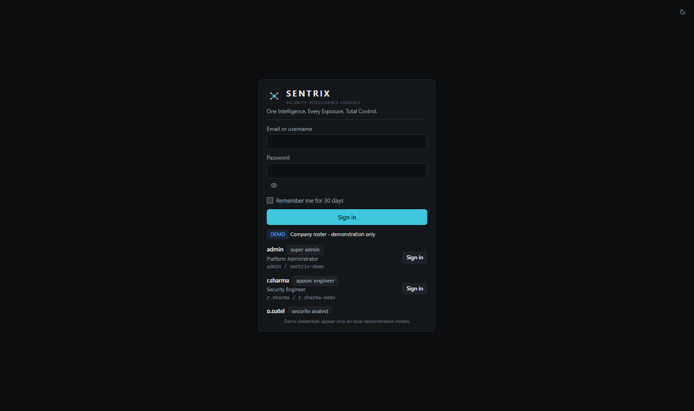
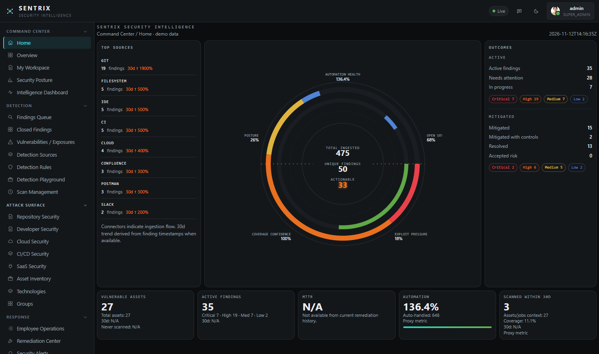
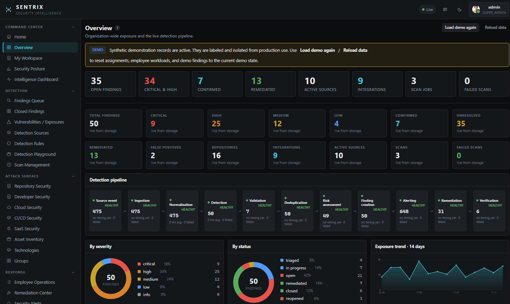
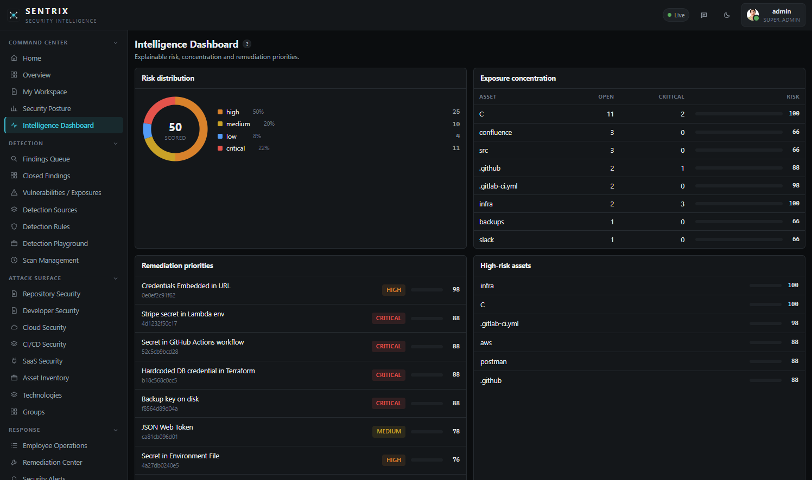
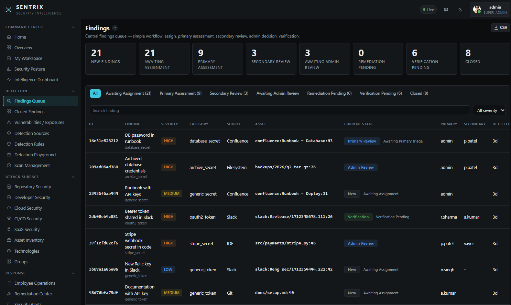
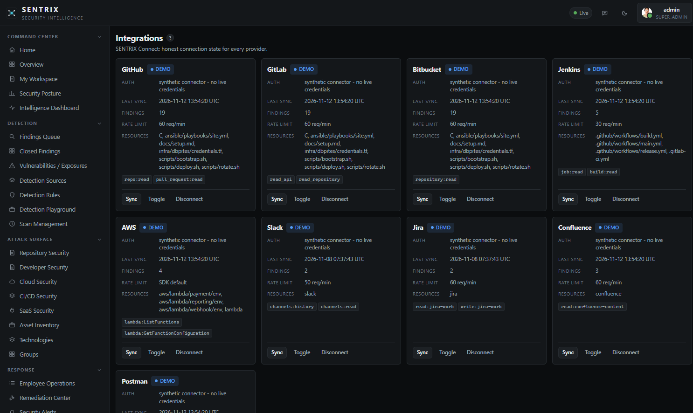
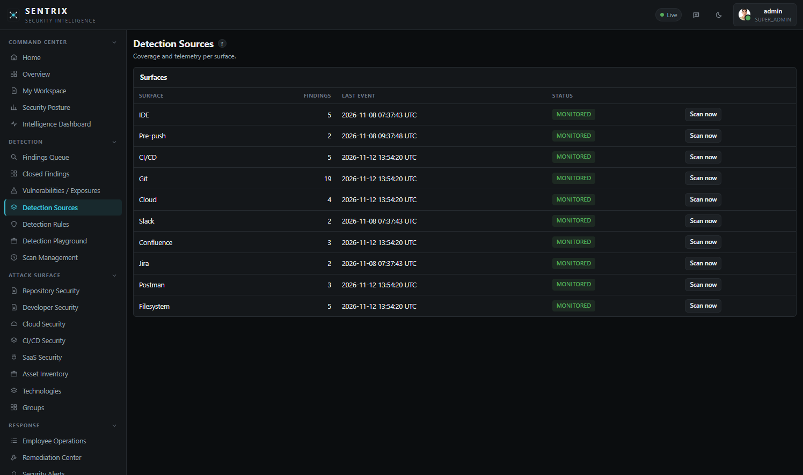
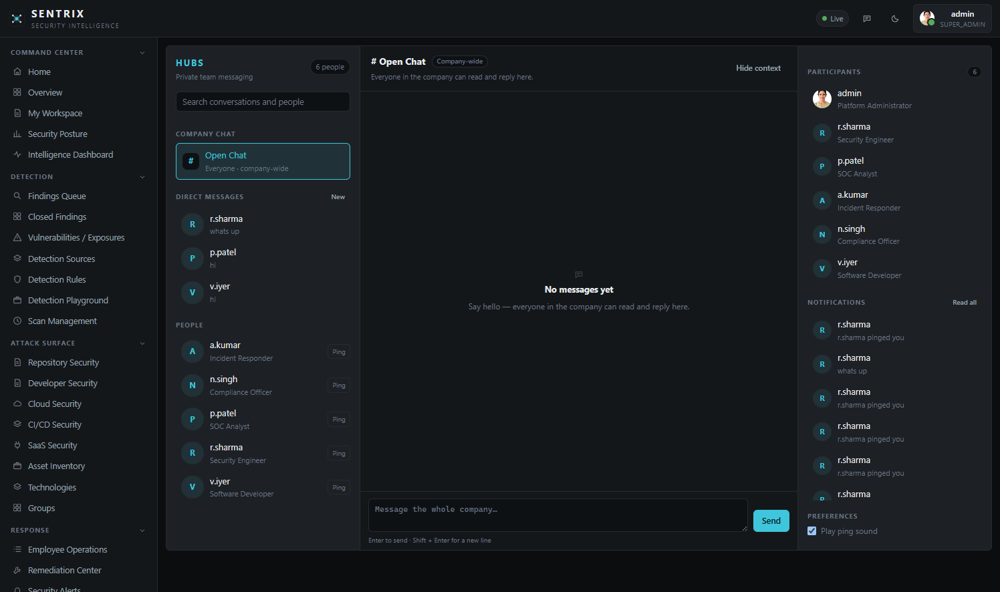
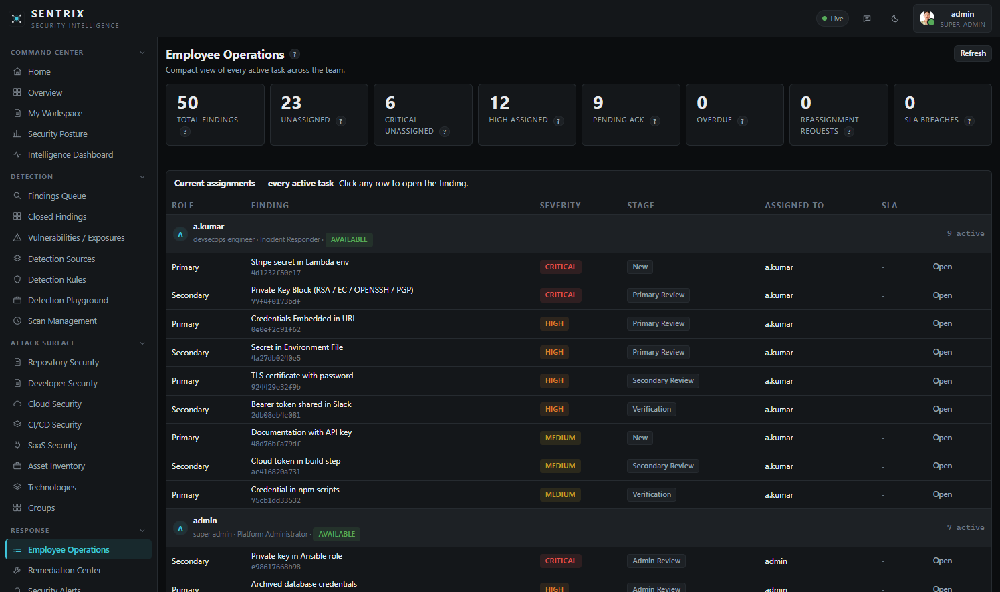
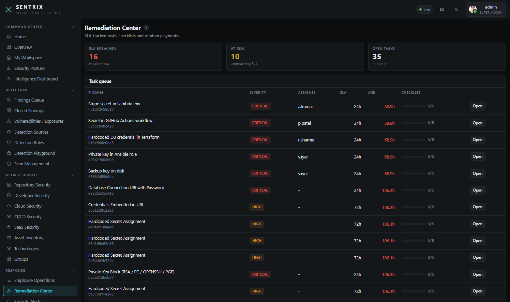

<div align="center">


# SENTRIX

**Secret Exposure & Network Threat Response Intelligence eXchange**

> One Intelligence. Every Exposure. Total Control.

[](LICENSE)
[](https://www.python.org/downloads/)
[](docs/DEPLOYMENT.md)
[](pyproject.toml)
[](#installation--quick-start)

A self-hosted, offline-first security intelligence platform that **finds, explains, prioritizes, routes, remediates, verifies, and monitors** exposed secrets across your engineering footprint — delivered as a single Python application with **no required runtime dependencies**.

[Overview](#overview) • [Problem](#problem-statement) • [Screenshots](#product-tour) • [Features](#core-capabilities) • [Advanced Features](#advanced-features-webhooks-monitoring-validation--archival) • [Architecture](#architecture) • [Quick Start](#installation--quick-start) • [Configuration](#configuration) • [API](#api-reference-overview) • [Security](#security-privacy-and-access-control) • [Docs](#documentation)

</div>

---

## Overview

**SENTRIX** is an enterprise-oriented **secret exposure detection and response platform** built as a local modular monolith. One Python 3.11+ process serves the:

- **Command Center** (web console / SPA)
- **JSON API** (for automation, integrations, and UI)
- **Detection engine** (shared intelligence across surfaces)
- **Alerting & response pipeline**
- **Background job runner and scheduler**
- **SQLite-backed operational datastore**

SENTRIX is designed to help security, AppSec, DevSecOps, platform, and incident-response teams continuously discover leaked credentials and sensitive material, understand blast radius and provenance, prioritize remediation using explainable risk, enforce accountable workflows, and verify closure — while preserving strict data-handling guarantees.

### Design principles

- **One intelligence, many surfaces:** detection logic is centralized; collection adapters only extract text/context.
- **No raw secret persistence:** findings are stored as **masked previews** and **SHA-256 fingerprints** (not plaintext secrets) across DB, logs, alerts, exports, and AI prompts.
- **Offline-first, dependency-light:** core functionality runs with Python stdlib only; optional integrations/features degrade gracefully.
- **Honest state reporting:** integrations and health views distinguish `connected` / `demo` / `disconnected` and other operational states without overstating certainty.
- **No silent closure:** disappearance is not proof of rotation; verification is explicit and closure decisions are auditable.
- **Additive evolution:** schema/config/API extensions are designed to be backward-compatible and migration-safe.

---

## Problem statement

Secret sprawl is a cross-system problem. Credentials leak into source code, git history, CI logs/config, local developer files, cloud function environments/artifacts, collaboration tools, and API workspaces. Organizations commonly struggle with:

- **Fragmented detection and visibility** across tools and teams
- **High noise and duplicate findings** for the same exposed secret
- **Poor prioritization** without explainable risk and exposure context
- **Unclear ownership and delayed response** due to weak assignment/review workflows
- **Unverified remediation** (removed from code but not rotated/revoked)
- **Limited auditability and evidence** for governance/compliance programs

SENTRIX unifies **collection → intelligence → workflow → response → governance** so teams can move from detection to verified closure with accountability and operational visibility.

---

## Product tour

A walkthrough of SENTRIX from sign-in through key operational views (10 screenshots).

| View | Screenshot |
| --- | --- |
| **1. Sign In**<br>Secure entry point to the SENTRIX Command Center. |  |
| **2. Home Dashboard**<br>At-a-glance posture, activity, and navigation hub. |  |
| **3. Overview**<br>Executive rollup of findings, sources, and outcomes. |  |
| **4. Intelligence Dashboard**<br>Prioritized intelligence and explainable risk context. |  |
| **5. Findings Queue**<br>Central queue for triage, review, and workflow actions. |  |
| **6. Integrations**<br>SENTRIX Connect providers, states, and operational metadata. |  |
| **7. Detection Sources**<br>Coverage across surfaces, repositories, and ingestion paths. |  |
| **8. Hubs**<br>Collaboration via company chat and direct messages. |  |
| **9. Employee Operations**<br>Assignments, workload balancing, and accountability. |  |
| **10. Remediation Center**<br>Playbooks, response actions, verification, and closure tracking. |  |

---

## Core capabilities

### 1) Unified secret detection intelligence
- **26 built-in detectors** across cloud, crypto, SaaS/dev, AI, and generic families
- **Custom detection rules** (config-defined and runtime-managed)
- Keyword-prefiltered regex matching, Shannon entropy analysis, format/validator heuristics
- Deterministic masking and stable **SHA-256 fingerprinting**
- Allowlisting (fingerprint registry, built-in safe placeholders, configurable regex patterns)
- Environment/path heuristics and provenance metadata (origin/surface/event context)

**Detector families (built-in):**
- **Cloud (6):** AWS access key/secret, GCP API key/service account, Azure storage connection/client secret
- **Crypto (5):** private key, SSH private key body, JWT, basic-auth URL, DB URI with password
- **SaaS/Dev (10):** GitHub/GitLab/Slack/Stripe/SendGrid/Twilio/npm/PyPI/Mailchimp tokens and webhooks
- **AI (2):** OpenAI and Anthropic keys
- **Generic (3):** generic secret assignment, high-entropy string, env-secret patterns

### 2) Multi-surface coverage (10 surfaces)
- **Filesystem** scans (file/tree, on-demand)
- **IDE/watch** ingestion (on-save and polling watcher)
- **Git diff scanning** (added-lines focus), **pre-commit/pre-push hooks**, and **CI diff gates**
- **Cloud/Lambda artifacts** (local exports by default; optional live AWS scanning)
- **Slack / Confluence / Jira** ingestion via exports and/or live REST polling (when configured)
- **Postman** collection/environment export scanning

### 3) Explainable risk scoring and deduplication
- **0–100 explainable risk score** with factor breakdown:
  - severity baseline, secret category, exposure surface, confidence, format validation, environment, age, repetition
- Risk banding for prioritization (critical/high/medium/low/info)
- **Dedupe strategy:**
  - in-scan dedupe by `(detector_id, fingerprint, path, line)`
  - cross-scan upsert by `fingerprint + path + line` with occurrence/last-seen tracking
- Prevents alert storms on repeated sightings while preserving visibility

### 4) Findings lifecycle, workflow, and governance
- **12-state lifecycle model** (compatibility superset) spanning intake, active handling, resolution, and exceptions
- Status history, notes, tags, pin/mute, checklists, saved filters, bulk actions, related findings
- **Structured review and accountability flows** (assignment, primary/secondary review, admin final disposition, reassessment/verification paths) with audited transitions
- Closed findings retained for audit/history
- **Governance artifacts:** audit trail, structured system logs/events, 11 report types (CSV/JSON), compliance evidence mapping views, retention purge/vacuum, backup/restore/import/export

### 5) Intelligent assignment and workload management
- Explainable **automatic / recommended / manual** assignment modes
- **Primary owner + secondary reviewer** model with RBAC-aware eligibility
- Considers severity/urgency, technical domain inference, skills/expertise, severity-weighted workload/capacity, availability, ownership context, conflicts, and SLA targets
- Assignment history, acknowledgements, reassignment/assist/escalation workflows
- Server-side enforcement of role permissions and admin-override auditing

### 6) Remediation, response, and verification
- **11 rotation playbooks** (AWS/GCP/Azure/GitHub/GitLab/Slack/Stripe/OpenAI/DB/keypair/generic)
- Actions: rotate guidance, preview-redact, redact, quarantine/restore, ticket creation, verification rescan
- **Ticketing:** live Jira integration when configured; outbox draft fallback otherwise
- **Alerting:** console/outbox and optional Slack/webhook channels with rules, dedupe window, quiet hours, retries/backoff, acknowledgements, and escalation behavior
- **Verification-first closure:** explicit rescans and human-accountable decisions (no automatic provider revocation)

### 7) SENTRIX Connect (integrations hub)
Tracks 9 providers with honest operational states (`connected`, `demo`, `disconnected`):
- **GitHub, GitLab, Bitbucket, Jenkins** (coverage via hooks/gates/scans/exports; no live API connector in Connect inventory)
- **AWS** (local artifact scans by default; optional live Lambda scanning with `boto3`/credentials)
- **Slack, Jira, Confluence** (export ingestion and live REST polling when configured; Jira ticketing supported)
- **Postman** (export-based ingestion/monitoring paths)

Sync operations are recorded as audited events/logs (sync does not implicitly fetch provider data unless explicitly implemented by the configured ingestion path).

### 8) Collaboration (Hubs)
- Shared **Open Chat** and private **1:1 DMs**
- Presence/heartbeats, read markers, notifications, and pings
- Per-user preferences (notification/sound/mute behavior)
- Message posting with edit/delete API support
- Privacy-aware access controls (DMs scoped to participants; role-aware write restrictions)

### 9) Command Center experience
- Hash-routed SPA (no frontend build step), dark/light themes, role-aware UI
- 27 primary views across Command Center, Detection, Attack Surface, Response, Collaboration, Operations, and Governance
- Finding drill-down, bulk operations, saved filters, reports/exports, telemetry dashboards, and contextual help

---

## Advanced features (webhooks, monitoring, validation & archival)

> These capabilities are implemented additively and exposed through configuration flags, scheduler tasks, and feature endpoints. They are designed to be non-breaking and to degrade gracefully when credentials/dependencies are unavailable.

### 1) GitHub Pull Request Secret Scanner
- **Webhook endpoint:** `POST /api/webhooks/github`
- Handles `pull_request` actions (e.g. opened/synchronize/reopened/edited/ready_for_review)
- Scans changed/added diff content (from payload patches and/or fetched PR files when GitHub API access is configured)
- Ingests findings with provenance (`webhook.github.pull_request`, repo/PR metadata)
- Supports optional webhook signature verification (`X-Hub-Signature-256`, via `SENTRIX_GITHUB_WEBHOOK_SECRET`)

### 2) GitHub Push Event Secret Scanner
- Handles `push` webhook events on the same GitHub webhook endpoint
- Scans commit patch hunks and/or fetches changed file content (when configured/tokenized API access is available)
- Ingests findings with provenance (`webhook.github.push`, repo/ref metadata)

### 3) GitHub Actions Automated Security Gates
- PR webhook scans compute a **gate result** (`pass`/`fail`) using `scan.fail_on` severity threshold
- Gate outcome is returned in webhook response and recorded in logs/events for CI/automation consumption
- Complements existing CLI/CI gate workflows (`sentrix gate`, hooks, pipeline templates)

### 3a) Real-Time SaaS and Deployment Webhooks (create/update & post-deploy)
- **Jira webhook:** `POST /api/webhooks/jira` scans issue/content payloads on create/update-style events in near real time (optional shared token verification via `SENTRIX_JIRA_WEBHOOK_SECRET`)
- **Confluence webhook:** `POST /api/webhooks/confluence` scans page/content payloads on create/update events in near real time (optional shared token verification via `SENTRIX_CONFLUENCE_WEBHOOK_SECRET`)
- **AWS Lambda deployment webhook:** `POST /api/webhooks/aws/lambda` triggers post-deployment Lambda/environment/artifact scans (optional shared token verification via `SENTRIX_AWS_WEBHOOK_TOKEN`) to support real-time deployment monitoring workflows
- All webhook deliveries are tracked for observability and missed-webhook detection; payload scanning flows through the unified detection pipeline (masking, fingerprinting, dedupe, risk, workflow/alerts)

### 4) Automatic Full Repository Rescanning
- Scheduler-triggered periodic repository/path rescans (`features.full_repo_rescan`)
- On-demand trigger: `POST /api/features/full-rescan`
- Uses existing bounded job runner (`queued/running/done/failed/cancelled`) for safe background execution

### 5) Real-Time AWS Lambda Deployment Monitoring
- Periodic real-time cloud scanning via scheduler tick (`features.aws_lambda_monitoring`, `features.realtime_monitoring.interval_seconds`)
- Event-driven post-deployment trigger support via `POST /api/webhooks/aws/lambda` (e.g. deployment/update events)
- Detects changes in Lambda configuration/environment and scanned artifacts over time (ingested through normal pipeline/dedupe flow)

### 6) AWS Multi-Account Secret Scanning
- Multi-account/profile/assume-role session support via `features.aws_multi_account.accounts`
- Enables centralized scanning across configured AWS accounts (when `boto3` and credentials/roles are available)

### 7) Lambda Environment Variable Scanning
- Scans Lambda environment variables from local artifacts and/or live AWS function configuration
- Preserves existing behavior and extends it in advanced monitoring paths

### 8) Lambda ZIP Artifact Scanning
- Downloads/scans Lambda deployment package contents (ZIP artifacts) for code/config secrets when enabled (`features.lambda_zip_scan`)
- Skips unsupported/oversized entries and scans common text/code/config file types

### 9) Real-Time Slack Secret Monitoring
- Scheduled real-time Slack live scans (configured token/channels) via feature scheduler (`features.realtime_slack_monitoring`)
- Uses existing Slack adapter semantics and degrades gracefully when unconfigured

### 10) Private Slack Channel Monitoring with Consent
- Consent-gated channel filtering via `features.slack_private_consent`
- When enabled, monitoring can be restricted to explicitly allowed channels (`allowed_channels`) to enforce operator consent boundaries

### 11) Real-Time Jira Secret Scanning
- Scheduled real-time Jira live scans (`features.realtime_jira_monitoring`) using configured Jira credentials/base URL
- Ingests detections through the unified pipeline (including SaaS handling paths)

### 12) Real-Time Confluence Secret Scanning
- Scheduled real-time Confluence live scans (`features.realtime_confluence_monitoring`) using configured credentials/base URL

### 13) Postman Workspace and Collection Monitoring
- Monitors configured local export paths (`features.postman_monitoring.export_paths`) on schedule
- Scans collections and environments (export-based monitoring path; additive to existing Postman ingest capabilities)

### 14) Automated API-Based Secret Validation
- **Endpoint:** `POST /api/features/validate-finding` (`{"id":"<finding_id>"}`)
- Opt-in feature (`features.secret_validation`) records validation outcomes in an additive `validation_results` store
- **Important privacy/implementation note:** SENTRIX does not persist raw secret values. As a result, live provider-API validation that requires transmitting the original secret cannot be performed from stored findings alone and is recorded as unavailable/format-only where applicable. The framework is additive and safe-by-default.

### 15) AWS S3 Centralized Audit Archival
- Archives audit/log/event bundles to S3 (`features.s3_audit_archival`) via `boto3`
- **On-demand:** `POST /api/features/archive-audit`
- **Scheduled:** periodic archival when enabled (`interval_seconds`, bucket/prefix configured)
- Records success/failure in logs and scan-failure tracking (non-fatal)

### 16) Missed Webhook and Failed Scan Detection
- Tracks webhook deliveries in `webhook_events` (provider/event/delivery/status/reason/timestamps/metadata)
- Tracks scan/job/webhook processing failures in `scan_failures`
- Detects missing/recently absent webhook activity across enabled providers (e.g. GitHub/Jira/Confluence/AWS) and surfaces signals in health endpoints

### 17) Integration Health and Coverage Monitoring
- **Primary endpoint:** `GET /api/features/health`
- Returns additive operational telemetry:
  - integration inventory states and metadata
  - coverage summary (surfaces with findings, integration state counts)
  - failed jobs/scans and recent scan failures
  - recent webhook events and missed-webhook indicators
- Supporting endpoints:
  - `GET /api/features/status` (feature enablement snapshot)
  - `GET /api/features/webhooks?provider=&limit=`
  - `GET /api/features/scan-failures?limit=`

---

## Architecture

### Runtime model
- **Single-process modular monolith** (Python 3.11+, stdlib-first)
- **HTTP server:** stdlib `ThreadingHTTPServer` serving console + API
- **Background execution:** bounded job runner (scan slots) + scheduler loop (schedules, escalations, maintenance, feature ticks)
- **Storage:** SQLite with thread-local connections, write locking, additive/idempotent migrations

### Logical layers
1. **Collection** — surface adapters, hooks, CI/gates, watchers, exports/live polling, webhooks
2. **Ingestion** — unified pipeline normalization (`pipeline.ingest`)
3. **Intelligence Core** — detectors, engine, entropy/validation/masking/fingerprinting, risk scoring, triage
4. **Security Management** — lifecycle, workflow state, notes/tags/history/checklists, assignment metadata
5. **Response** — alerting, escalation, remediation playbooks/actions, verification
6. **Control Plane** — API, auth/RBAC, jobs/schedules, integrations, reports, ops, feature endpoints
7. **Storage** — SQLite schema, migrations, events/audit/logs, operational records

### High-level data flow
```text
Event source
  (save/watch, git/CI diff, webhook, export/live poll, scheduled scan, API)
        │
        ▼
Surface adapter / webhook handler
        │
        ▼
Detection engine (scan_text/scan_file/scan_tree)
  detector match → validation/entropy → allowlist → mask + fingerprint
        │
        ▼
Pipeline ingest (single normalization path)
  provenance + risk → dedupe upsert → events/logs
    • new finding  → alerting / auto-ticket (policy) / assignment hooks
    • known finding → occurrences & last_seen updated
        │
        ▼
Workflow & response
  assignment/review → remediation/playbooks → verification rescan → closure
        │
        ▼
Governance & monitoring
  audit/logs/reports/compliance + integration health/webhook/failure tracking
```

### Repository structure
```text
SENTRIX/
├── sentrix/
│   ├── core/                # Engine, pipeline, storage, risk, jobs, assignment, integrations, reports
│   ├── detectors/           # Built-in detector registry and implementations
│   ├── surfaces/            # Filesystem/IDE/Git/Cloud/Slack/Confluence/Jira/Postman adapters
│   ├── alerting/            # Alert routing and delivery
│   ├── remediation/         # Playbooks and response actions
│   ├── ai/                  # Heuristic and optional GPT triage (masked-only)
│   ├── hubs/                # Collaboration (channels/DMs/presence/notifications)
│   ├── dashboard/           # SPA assets (HTML/CSS/JS)
│   ├── features/            # Additive advanced features (webhooks, monitoring, validation, archival)
│   ├── server.py            # HTTP server, routing, auth/RBAC, API dispatch
│   ├── auth.py              # Auth, sessions, RBAC, tokens, audit helpers
│   └── cli.py               # CLI entrypoint and commands
├── hooks/                   # Git hooks (pre-commit/pre-push)
├── ci/                      # CI templates (GitLab, Jenkins)
├── editors/vscode/          # VS Code integration
├── docs/                    # Product/architecture/API/security/deployment documentation
├── examples/                # Demo fixtures and sample exports/artifacts
├── tests/                   # Automated tests
├── sql/                     # SQL/schema assets
├── assets/                  # Branding/static assets
├── config.toml              # Default configuration
├── run.py / run.bat / run.sh
└── pyproject.toml
```

---

## Installation & quick start

### Prerequisites
- **Python 3.11+**
- **Windows / Linux / macOS** (local/dev use supported on Kali as well)
- No required third-party runtime packages (stdlib-only core)

### Start the server

**Windows**
```bat
run.bat
```

**Linux / macOS**
```sh
chmod +x run.sh
./run.sh
# or
python3 run.py
```

**Any platform**
```sh
python run.py serve --port 8710
```

Open the Command Center: **http://127.0.0.1:8710**

### Optional dependencies (feature-specific)
```sh
# Optional: live AWS Lambda scanning / multi-account / ZIP scan / S3 archival
pip install boto3
# or
pip install .[aws]
```

### Local demo accounts (loopback/demo installs only)
On first run in demo mode, SENTRIX may bootstrap local demo accounts/data for exploration.

| Username | Role | Demo password |
| --- | --- | --- |
| `admin` | `super_admin` | `sentrix-demo` |
| `r.sharma` | `appsec_engineer` | `r.sharma-demo` |
| `p.patel` | `security_analyst` | `p.patel-demo` |
| `a.kumar` | `devsecops_engineer` | `a.kumar-demo` |
| `n.singh` | `auditor` (read-only) | `n.singh-demo` |
| `v.iyer` | `developer` (read-only) | `v.iyer-demo` |

> Demo credentials are intended for local demonstration only. Disable demo mode, change/remove demo accounts, and harden configuration before any non-demo or shared deployment.

---

## CLI usage

```sh
# Start server (default)
python run.py
python run.py serve --port 8710

# Scan files/directories
python run.py scan PATH [--surface filesystem] [--json] [--no-store] [--strict]

# Diff-based blocking gate (hooks/CI)
python run.py gate --staged
python run.py gate --range BASE..HEAD
python run.py hooks install --repo .
python run.py hooks uninstall --repo .

# Watch local paths (polling)
python run.py watch PATH [--interval 2.0]

# Ingest supported surfaces/exports
python run.py ingest --surface {slack,confluence,jira,postman,postman-env,cloud,ide} [--file PATH] [--json]

# Operations and utilities
python run.py demo
python run.py selftest
python run.py report [--format md|json]
python run.py surfaces
python run.py jobs
python run.py schedules {add|list} ...
python run.py allowlist {add FINGERPRINT [--reason]|list}
python run.py triage ID
python run.py remediate ID --action {redact,quarantine,ticket,rotate-guide}
python run.py users {add USERNAME|list} [--password] [--role ...]
python run.py tokens {create|list|revoke} ...
python run.py backup [--dest PATH]
```

---

## Configuration

SENTRIX uses layered configuration:

1. Built-in defaults (`sentrix/config.py`)
2. `config.toml`
3. `config.local.toml` (recommended for local/production overrides; keep secrets out of VCS)
4. Environment variables for secrets and selected runtime values

### Core sections
- `[server]` — bind host/port
- `[auth]` — session, rate limiting, demo/roster behavior
- `[scan]` — scan limits, entropy threshold, ignore rules, fail threshold, allowlist patterns
- `[storage]` — SQLite path
- `[alerting]` — channels, dedupe, escalation, quiet hours, auto-ticket policy
- `[detectors]` — enable/disable, severity overrides, custom detectors
- `[ai]` — optional masked GPT triage (disabled by default)
- `[surfaces.*]` — Slack/Confluence/Jira/Postman/Cloud connector configuration

### Advanced feature sections (`[features.*]`)
```toml
[features.github]
token_env = "SENTRIX_GITHUB_TOKEN"
webhook_secret_env = "SENTRIX_GITHUB_WEBHOOK_SECRET"
api_base = "https://api.github.com"

[features.jira_webhook]
enabled = true
secret_env = "SENTRIX_JIRA_WEBHOOK_SECRET"

[features.confluence_webhook]
enabled = true
secret_env = "SENTRIX_CONFLUENCE_WEBHOOK_SECRET"

[features.aws_deployment_webhook]
enabled = true
token_env = "SENTRIX_AWS_WEBHOOK_TOKEN"

[features.github_webhooks]
enabled = true

[features.github_pr_scanner]
enabled = true

[features.github_push_scanner]
enabled = true

[features.github_actions_gate]
enabled = true

[features.full_repo_rescan]
enabled = true
paths = []
interval_seconds = 86400

[features.aws_lambda_monitoring]
enabled = true

[features.aws_multi_account]
enabled = true
accounts = [] # e.g. [{ name="prod", profile="prod-readonly", region="us-east-1" }, { name="audit", role_arn="arn:aws:iam::123456789012:role/SentrixScan" }]

[features.lambda_env_scan]
enabled = true

[features.lambda_zip_scan]
enabled = true

[features.realtime_slack_monitoring]
enabled = true

[features.slack_private_consent]
enabled = false
allowed_channels = []

[features.realtime_jira_monitoring]
enabled = true

[features.realtime_confluence_monitoring]
enabled = true

[features.postman_monitoring]
enabled = true
export_paths = []

[features.secret_validation]
enabled = false
github_api = false

[features.s3_audit_archival]
enabled = false
bucket = ""
prefix = "sentrix/audit/"
interval_seconds = 3600

[features.missed_webhook_detection]
enabled = true

[features.integration_health_monitoring]
enabled = true

[features.realtime_monitoring]
interval_seconds = 300
```

### Environment variables (common)
| Variable | Purpose |
| --- | --- |
| `SENTRIX_ADMIN_PASSWORD` | Bootstrap/admin password (recommended outside demo use) |
| `SENTRIX_TEAM_PASSWORD` | Team bootstrap support (where applicable) |
| `SENTRIX_GITHUB_TOKEN` | GitHub API access for webhook enrichment/scans (optional) |
| `SENTRIX_GITHUB_WEBHOOK_SECRET` | GitHub webhook HMAC signature verification secret (recommended) |
| `SENTRIX_JIRA_WEBHOOK_SECRET` | Shared token for Jira webhook verification (optional but recommended) |
| `SENTRIX_CONFLUENCE_WEBHOOK_SECRET` | Shared token for Confluence webhook verification (optional but recommended) |
| `SENTRIX_AWS_WEBHOOK_TOKEN` | Shared token for AWS deployment webhook verification (optional but recommended) |
| `SENTRIX_SLACK_TOKEN` | Slack API token (live scans/monitoring) |
| `SENTRIX_JIRA_TOKEN` | Jira API token (live scans/ticketing) |
| `SENTRIX_CONFLUENCE_TOKEN` | Confluence API token (live scans) |
| `SENTRIX_POSTMAN_KEY` | Postman API key (if configured paths/flows require it) |
| `SENTRIX_AI_KEY` | Optional AI triage API key (masked-only usage) |
| `SENTRIX_HOME` | Hook/runtime resolution aid for git hooks |
| AWS credentials / profile / role chain | Standard AWS SDK credential resolution for live AWS/S3 features |

---

## API reference (overview)

SENTRIX exposes a JSON-first API (same host/port as the console). Authentication supports session cookie/session token flows and bearer API tokens (`Authorization: Bearer sxt_...`) with RBAC enforcement.

### Core endpoint groups
- **Auth & identity:** `/api/auth/*`, `/api/users*`, `/api/tokens*`
- **Dashboard & telemetry:** `/api/home`, `/api/overview`, `/api/stats`, `/api/dashboard`, `/api/posture`, `/api/intelligence`, `/api/pipeline`, `/api/metrics`
- **Findings & workflow:** `/api/findings*`, finding subresources/history/notes/checklists/bulk actions, triage/remediation endpoints
- **Detection & scanning:** `/api/scan`, `/api/jobs*`, `/api/schedules*`, `/api/detectors*`, `/api/detection-rules*`, `/api/allowlist`, `/api/sources`, `/api/assets`
- **Response & operations:** `/api/alerts*`, `/api/events`, `/api/logs*`, `/api/audit`, `/api/remediation*`, `/api/reports*`, `/api/exceptions`, `/api/compliance`, `/api/ops/*`
- **Integrations & assignment:** `/api/integrations*`, `/api/assignment/*`, `/api/help*`
- **Collaboration:** `/api/hubs/*`

### Advanced feature endpoints (additive)
- **Webhook ingestion (public, signature/token-verifiable as configured):**
  - `POST /api/webhooks/github` — GitHub PR/push/ping webhook receiver (PR/push scanning, gate result, event tracking)
  - `POST /api/webhooks/jira` — Jira create/update webhook receiver (real-time payload scanning)
  - `POST /api/webhooks/confluence` — Confluence create/update webhook receiver (real-time payload scanning)
  - `POST /api/webhooks/aws/lambda` — AWS Lambda deployment/update webhook receiver (post-deploy scan trigger)
- **Feature health & monitoring (authenticated API access per server policy):**
  - `GET /api/features/status` — feature enablement snapshot
  - `GET /api/features/health` — integration health/coverage, failed scans/jobs, recent/missed webhooks, scan failures
  - `GET /api/features/webhooks?provider=&limit=` — webhook event history
  - `GET /api/features/scan-failures?limit=` — scan failure history
- **Feature operations (authenticated; additive):**
  - `POST /api/features/full-rescan` — trigger configured full repository rescans
  - `POST /api/features/realtime-scan` — trigger a real-time scan for a supported surface (e.g. `{"surface":"slack"}`)
  - `POST /api/features/archive-audit` — archive audit/log/event bundle to S3 (if configured)
  - `POST /api/features/validate-finding` — record validation result for a finding (`{"id":"<finding_id>"}`)

> For exact payloads, filters, and role requirements, refer to `docs/API.md` and server route behavior in `sentrix/server.py`.

---

## Security, privacy, and access control

### Data protection and privacy
- **No raw secret persistence:** masked previews and SHA-256 fingerprints only
- **No external secret exfiltration by default:** outbound calls are limited to explicitly configured services/features
- **Masked telemetry:** alerts, logs, exports, and optional AI triage inputs avoid raw secret values
- **Quarantine caution:** quarantine/remediation artifacts may contain sensitive original material under operator control; protect `data/` accordingly

### Authentication, authorization, and request protections
- **Password hashing:** PBKDF2-HMAC-SHA256 (200k iterations, random salt)
- **Sessions:** server-side sessions with `HttpOnly`, `SameSite=Strict` cookie semantics and configurable expiry
- **RBAC:** 8 roles with server-side enforcement (`super_admin`, `security_admin`, `security_analyst`, `appsec_engineer`, `devsecops_engineer`, `developer`, `auditor`, `viewer`)
- **API tokens:** admin-managed bearer tokens (`sxt_`), hashed at rest, revocable
- **Login protection:** per-IP rate limiting on failed attempts
- **CSRF/origin controls:** enforced for cookie-authenticated mutations (with scoped exemptions for verified/public webhook flows)
- **Security headers:** restrictive defaults (`no-store`, CSP, frame/referrer/permissions/COOP/CORP policies)
- **Outbound safety:** SSRF guard checks for configured outbound HTTP targets

### Production hardening (recommended)
- Set `auth.demo_mode = false` in `config.local.toml`
- Bind to loopback or place behind a TLS reverse proxy with strict access controls
- Set strong `SENTRIX_ADMIN_PASSWORD`; rotate/remove demo credentials
- Protect `data/` (SQLite DB, backups, quarantine, generated initial secrets/files)
- Use least-privilege tokens/scopes for GitHub/Slack/Jira/Confluence/AWS/S3 integrations
- Enable webhook signature verification (`SENTRIX_GITHUB_WEBHOOK_SECRET`) and monitor webhook/failure telemetry
- Review `docs/SECURITY.md`, `docs/DEPLOYMENT.md`, and `docs/PRIVACY.md`

---

## Testing and validation

```sh
# Built-in sanity checks
python run.py selftest

# Unit/integration tests
python -m unittest discover -s tests -v

# Pytest (if installed)
python -m pytest tests -q
```

The repository includes tests covering core detection/pipeline behavior, workflows/assignment/review, integrations, Hubs, browser/smoke flows, posture/scans, and stress scenarios (see `tests/`).

---

## Documentation

| Document | Description |
| --- | --- |
| [docs/OVERVIEW.md](docs/OVERVIEW.md) | Product overview, layers, lifecycle, design principles |
| [docs/ARCHITECTURE.md](docs/ARCHITECTURE.md) | Architecture, boundaries, concurrency, data flow |
| [docs/INSTALL.md](docs/INSTALL.md) | Installation instructions |
| [docs/DEPLOYMENT.md](docs/DEPLOYMENT.md) | Deployment, production mode, backup/restore, upgrades |
| [docs/API.md](docs/API.md) | API behavior and endpoint reference |
| [docs/DATABASE.md](docs/DATABASE.md) | Schema, tables, migrations, retention/ops |
| [docs/DETECTION_ENGINE.md](docs/DETECTION_ENGINE.md) | Detection pipeline, entropy, masking, fingerprinting, risk, dedupe |
| [docs/DETECTORS.md](docs/DETECTORS.md) | Detector catalog |
| [docs/SURFACES.md](docs/SURFACES.md) | Surface adapters and ingestion modes |
| [docs/INTEGRATIONS.md](docs/INTEGRATIONS.md) | SENTRIX Connect providers and sync/state semantics |
| [docs/ASSIGNMENT.md](docs/ASSIGNMENT.md) | Assignment, workload, SLA, accountability model |
| [docs/REMEDIATION.md](docs/REMEDIATION.md) | Remediation playbooks and verification flows |
| [docs/AI_TRIAGE.md](docs/AI_TRIAGE.md) | Heuristic and optional GPT triage (masked-only) |
| [docs/SECURITY.md](docs/SECURITY.md) | Security model, controls, and hardening guidance |
| [docs/PRIVACY.md](docs/PRIVACY.md) | Privacy and data handling |
| [docs/FLOWCHART.md](docs/FLOWCHART.md) | Flow diagrams |
| [docs/HELP_REGISTRY.md](docs/HELP_REGISTRY.md) | Contextual help registry |
| [docs/RESEARCH_SYNTHESIS.md](docs/RESEARCH_SYNTHESIS.md) | Research synthesis/background |

---

## Responsible use

- Never test with real production credentials; use synthetic fixtures/examples.
- Never paste raw secrets into issues, tickets, chats, or logs.
- Treat quarantine artifacts and backups as sensitive data.
- Report vulnerabilities privately through the project’s security disclosure process ([SECURITY.md](SECURITY.md), [docs/SECURITY.md](docs/SECURITY.md)).

SENTRIX improves detection, triage, response, and governance for secret exposure — but it does **not** replace provider-side credential rotation/revocation, incident response procedures, or formal compliance certification.

---

## License

SENTRIX is released under the [MIT License](LICENSE).

Demo assets (including avatars/fixtures) are intended for demonstration and should be reviewed or replaced for production use where appropriate.

---

<div align="center">

**SENTRIX** · Secret Exposure & Network Threat Response Intelligence eXchange  
*One Intelligence. Every Exposure. Total Control.*

</div>
