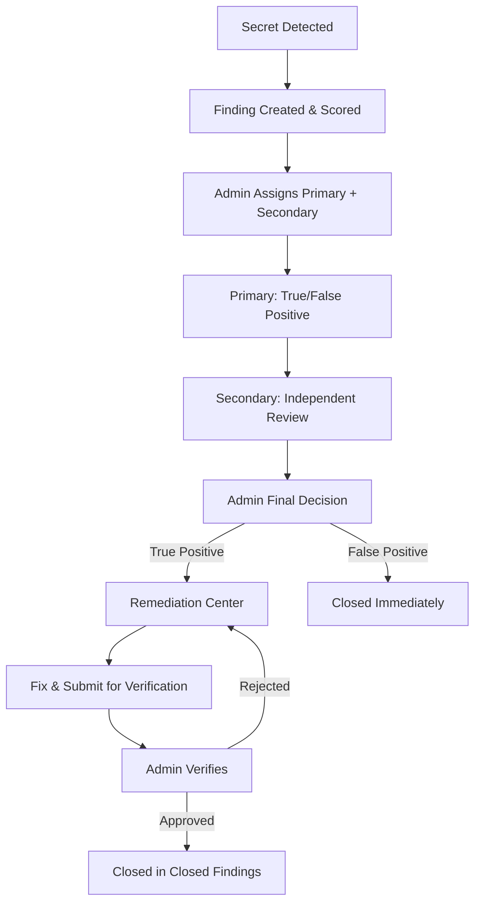

<div align="center">


# SENTRIX

**Secret Exposure & Network Threat Response Intelligence eXchange**

> One Intelligence. Every Exposure. Total Control.

[](LICENSE)
[](https://www.python.org/downloads/)
[](docs/DEPLOYMENT.md)
[](tests/)
[](#installation)

</div>

---

## What SENTRIX Does

SENTRIX is a self-hosted, offline-first security intelligence platform that finds, prioritizes, routes, remediates, and verifies exposed secrets across your entire engineering footprint — all from a single Python application with **zero required dependencies**.

It detects credentials, API keys, tokens, and other sensitive values wherever they leak (source code, git history, IDEs, pre-commit/pre-push hooks, CI/CD, cloud functions, Slack/Confluence/Jira/Postman, and the filesystem), scores them with an explainable risk engine, assigns them to the right owners with intelligent workload balancing, drives them through a structured review/remediation workflow, and proves closure with verification rescans.

**Key principle:** Only masked previews and SHA-256 fingerprints are ever stored or transmitted — raw secrets are never persisted in the database, logs, alerts, or AI prompts.

---

## Core Capabilities

| Capability | Description |
| --- | --- |
| **Unified Detection** | 26 built-in detectors (cloud, crypto, SaaS, AI, generic) with Shannon entropy scoring, format validation, environment classification, and custom rule support. Runs identically across all surfaces. |
| **Full-Surface Coverage** | Scans IDE on-save, git diffs/history, pre-commit/pre-push hooks, CI gates, filesystem trees, AWS Lambda artifacts, Slack/Confluence/Jira/Postman exports/live polls, and more. |
| **Intelligent Risk Scoring** | Explainable 0–100 risk scores based on severity, category, exposure surface, confidence, validation, environment, age, and repetition. Every score includes factor breakdown. |
| **Smart Deduplication** | Fingerprint-based deduplication across surfaces and scans. The same credential found in multiple locations is tracked as one finding with occurrence counts. |
| **Command Center Console** | Full-screen dark/light SPA with 27 views: posture analytics, intelligence prioritization, findings workflow, attack surface inventory, remediation board, alerts, reports, compliance, Hubs (chat/DMs), and more. |
| **Intelligent Assignment & Workload** | Automated/recommended/manual assignment engine that routes findings based on severity, domain, skills/expertise, severity-weighted workload, availability, and RBAC. Supports primary owner + secondary reviewer with full accountability. |
| **Structured Review Workflow** | Three-stage review (Primary → Secondary → Admin). Admin makes final disposition: true positives go to Remediation Center, false positives close immediately. All transitions are audited. |
| **Response & Remediation** | 11 rotation playbooks, redact/quarantine/restore actions, Jira ticketing (live or outbox), verification rescans, SLA tracking with escalation, and remediation task board. |
| **Integrations Hub (SENTRIX Connect)** | Nine providers (GitHub, GitLab, Bitbucket, Jenkins, AWS, Slack, Jira, Confluence, Postman) with honest connection states. Live-capable where configured, export-based otherwise. |
| **Collaboration (Hubs)** | Company-wide open chat and private 1:1 DMs with presence/pings/notifications. DMs are private with no admin oversight. Per-tab sessions keep accounts separate. |
| **Governance & Compliance** | Audit trail, structured logging, 11 report types, SOC 2/ISO 27001/PCI DSS/NIST CSF evidence mapping, retention/purge, backup/restore. |
| **RBAC & Security** | 8 roles, PBKDF2-HMAC-SHA256 passwords (200k iterations), HttpOnly SameSite sessions, per-IP rate limiting, CSRF protection, hashed API tokens, read-only role enforcement. |

---

## Quick Start

### Prerequisites
- Python 3.11+ (stdlib only; `boto3` optional for live AWS scanning)
- Windows, Linux, macOS

### Install & Run

**Windows:**
```bat
run.bat
```

**Linux / macOS:**
```sh
chmod +x run.sh
./run.sh
# or
python3 run.py
```

**Any platform:**
```sh
python run.py serve --port 8710
```

Open **http://127.0.0.1:8710** in your browser. On first run with demo mode enabled (default), an admin account and demo team are created for exploration.

### Demo Accounts (local only)
| Account | Role | Demo Password |
| --- | --- | --- |
| `admin` | `super_admin` | `sentrix-demo` |
| `r.sharma` | `appsec_engineer` | `r.sharma-demo` |
| `p.patel` | `security_analyst` | `p.patel-demo` |
| `a.kumar` | `devsecops_engineer` | `a.kumar-demo` |
| `n.singh` | `auditor` (read-only) | `n.singh-demo` |
| `v.iyer` | `developer` (read-only) | `v.iyer-demo` |

> Change passwords on first login. Demo credentials disappear when passwords change, server binds to non-loopback, or `auth.demo_mode = false`. See [Production Mode](#production-mode) below.

### CLI Usage
```sh
sentrix serve [--port N]           # Start Command Center + API
sentrix scan PATH [--surface S]    # Scan files/trees
sentrix gate --staged              # Diff-only blocking gate for hooks/CI
sentrix hooks install --repo .     # Install pre-commit/pre-push gates
sentrix demo                       # Seed synthetic findings
sentrix selftest                   # Sanity checks
sentrix report [--format md|json]  # Generate findings report
sentrix backup [--dest PATH]       # Backup SQLite DB
```

---

## Architecture

SENTRIX is a **modular monolith**: one Python process, one SQLite database, stdlib HTTP server, no build step.

```
SENTRIX/
├── sentrix/
│   ├── server.py           # Stdlib HTTP server, JSON API, static console
│   ├── auth.py             # Sessions, RBAC (8 roles), tokens, audit
│   ├── cli.py              # CLI interface
│   ├── core/               # Engine, pipeline, storage, risk, jobs, assignment
│   ├── detectors/          # 26 detectors + registry + custom rules
│   ├── surfaces/           # Adapters (IDE, git, filesystem, cloud, Slack, Jira, Confluence, Postman)
│   ├── alerting/           # Router, rules, quiet hours, deduplication
│   ├── remediation/        # Playbooks, redact/quarantine/ticket/verify
│   ├── ai/                 # Heuristic + optional GPT triage (masked only)
│   ├── hubs/               # Chat/DMs, presence, pings
│   └── dashboard/          # SPA console (HTML/CSS/JS)
├── hooks/                  # Git pre-commit/pre-push gates
├── ci/                     # GitLab CI, Jenkins templates
├── editors/vscode/         # VS Code on-save extension
├── docs/                   # Comprehensive documentation
└── tests/                  # Unit + integration tests
```

**Detection flow:** Source event → Surface adapter → Engine (detectors/entropy/validation) → Pipeline (provenance/risk/dedupe) → Alerting → Assignment/Review → Remediation → Verification → Closure

---

## Finding Workflow



- **Every transition audited** with actor, timestamp, and reason
- **Admin cannot** do primary/secondary reviews — only final disposition
- **Primary → Secondary → Admin** is enforced
- **Verification required** before closure for true positives
- **All closed findings retained** in Closed Findings (never deleted)

---

## Production Mode

For non-demo deployments:

1. Create `config.local.toml` (gitignored):
```toml
[auth]
demo_mode = false

[server]
host = "127.0.0.1"  # Keep on loopback or behind TLS reverse proxy
```

2. Set admin password via environment:
```sh
export SENTRIX_ADMIN_PASSWORD="strong-passphrase"  # Linux/macOS
set SENTRIX_ADMIN_PASSWORD=strong-passphrase       # Windows
```

3. Change/remove demo accounts, disable unused accounts, review [hardening checklist](docs/SECURITY.md#hardening-checklist).

See [docs/DEPLOYMENT.md](docs/DEPLOYMENT.md) for service setup, backups, upgrades, and VMware/Kali access instructions.

---

## Documentation

| Document | Description |
| --- | --- |
| [docs/OVERVIEW.md](docs/OVERVIEW.md) | Product overview, layers, architecture |
| [docs/INSTALL.md](docs/INSTALL.md) | Platform-specific installation |
| [docs/DEPLOYMENT.md](docs/DEPLOYMENT.md) | Production deployment, backup/restore, services |
| [docs/ARCHITECTURE.md](docs/ARCHITECTURE.md) | Modular monolith design, internals |
| [docs/API.md](docs/API.md) | Complete API reference (all endpoints) |
| [docs/DATABASE.md](docs/DATABASE.md) | Schema, tables, migrations, retention |
| [docs/DETECTION_ENGINE.md](docs/DETECTION_ENGINE.md) | Detectors, entropy, risk, deduplication |
| [docs/DETECTORS.md](docs/DETECTORS.md) | Full detector catalog |
| [docs/SURFACES.md](docs/SURFACES.md) | Surface adapters |
| [docs/INTEGRATIONS.md](docs/INTEGRATIONS.md) | SENTRIX Connect providers |
| [docs/ASSIGNMENT.md](docs/ASSIGNMENT.md) | Intelligent assignment & workload management |
| [docs/REMEDIATION.md](docs/REMEDIATION.md) | Playbooks and remediation actions |
| [docs/AI_TRIAGE.md](docs/AI_TRIAGE.md) | Heuristic and GPT triage |
| [docs/SECURITY.md](docs/SECURITY.md) | Auth, RBAC, hardening, disclosure |
| [docs/PRIVACY.md](docs/PRIVACY.md) | Data handling and privacy |
| [docs/HELP_REGISTRY.md](docs/HELP_REGISTRY.md) | Contextual help system |
| [docs/TROUBLESHOOTING.md](docs/TROUBLESHOOTING.md) | Common issues and fixes |

---

## Testing

```sh
python -m unittest discover -s tests -v
python -m pytest tests -q  # if pytest available
python run.py selftest
```

---

## Security & Privacy

- **No secret storage:** Raw values never persisted; only masked previews + SHA-256 fingerprints
- **Offline by default:** No telemetry, no phone-home; live connectors are opt-in
- **Private DMs:** Hubs direct messages visible only to participants, no admin oversight
- **No external validation:** Credentials never sent to providers to test validity
- **Responsible disclosure:** Report vulnerabilities privately via Security → Report a vulnerability. Never test with live credentials or paste real secrets in reports.

---

## License

SENTRIX is released under the [MIT License](LICENSE).

**Third-party assets:** Demo avatars from [randomuser.me](https://randomuser.me/) are for interface demonstration only — replace in production. Logo/favicon are original assets. No third-party JS/CSS/Python dependencies bundled.

---

<div align="center">

**SENTRIX** · Secret Exposure & Network Threat Response Intelligence eXchange

One Intelligence. Every Exposure. Total Control.

`http://127.0.0.1:8710`

</div>
