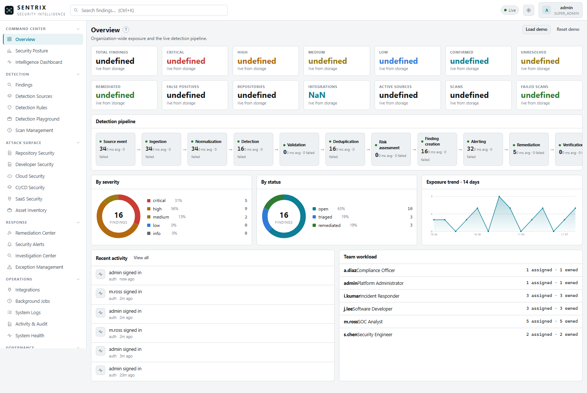
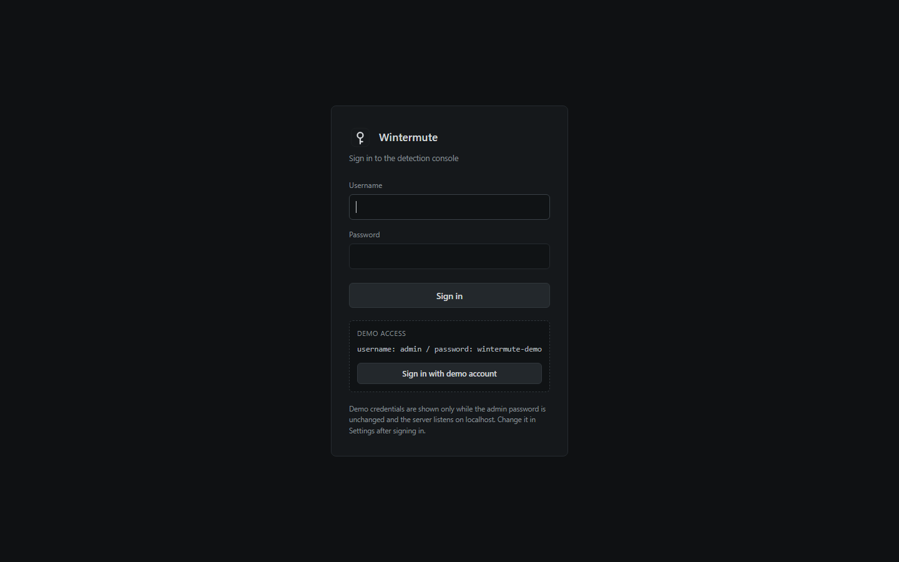
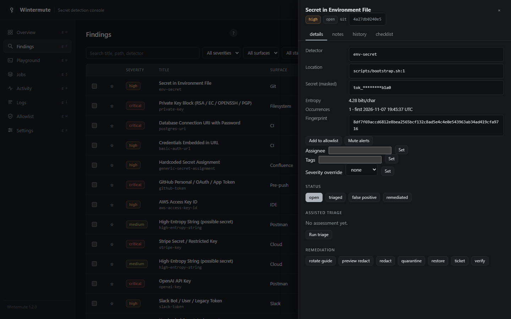

# SENTRIX

**Secret Exposure & Network Threat Response Intelligence eXchange**

> One Intelligence. Every Exposure. Total Control.


[](LICENSE)
[](https://www.python.org/downloads/)
[](docs/DEPLOYMENT.md)

SENTRIX is an enterprise security intelligence platform for secret security: it detects credential exposure across every surface a modern engineering organization uses, scores and prioritizes the risk, routes alerts to the right people, and drives remediation to verified closure. One shared intelligence core — a registry of 26 detectors plus entropy scoring, validation heuristics, allowlisting and explainable risk scoring — powers the editor, git hooks, CI gates, cloud functions, collaboration tools and the filesystem alike. Findings are masked, fingerprinted and deduplicated; raw secrets are never stored. The entire platform runs on the Python 3.11+ standard library with zero required dependencies and works fully offline.

SENTRIX is built for DevSecOps teams that need exposure detection, investigation workflow, automated response and audit-ready evidence in one console rather than five disconnected tools.

## Quickstart

### Windows

```bat
run.bat
```

### Kali / Linux / macOS

```sh
./run.sh
```

### Any platform, explicitly

```sh
python run.py          # Python 3.11+; starts the Command Center
```

With no arguments SENTRIX serves the console at **http://127.0.0.1:8710**. On first run it creates the `admin` account (role `super_admin`) and, unless `SENTRIX_ADMIN_PASSWORD` is set, writes the initial password to `data/INITIAL_ADMIN_PASSWORD.txt`. If the findings store is empty, synthetic demo findings are seeded automatically so every view is explorable immediately.

### Login and the demo roster

The shipped `config.toml` enables `auth.demo_mode`. While demo mode is on **and** the server listens on loopback, the login page shows a demo company roster with one-click sign-in:

| Account | Role | Title | Demo password |
| --- | --- | --- | --- |
| `admin` | `super_admin` | Platform Administrator | `sentrix-demo` |
| `r.sharma` | `appsec_engineer` | Security Engineer | `r.sharma-demo` |
| `p.patel` | `security_analyst` | SOC Analyst | `p.patel-demo` |
| `a.kumar` | `devsecops_engineer` | Incident Responder | `a.kumar-demo` |
| `n.singh` | `auditor` | Compliance Officer | `n.singh-demo` |
| `v.iyer` | `developer` | Software Developer | `v.iyer-demo` |

These credentials are **local-only**: the roster card disappears as soon as an account's password is changed, when the server binds to a non-loopback host, or when `auth.demo_mode = false` (production mode). In production mode no demo accounts are seeded and no credentials are ever displayed. Change the admin password after first login and delete the plaintext password file. See [docs/SECURITY.md](docs/SECURITY.md) and [docs/DEPLOYMENT.md](docs/DEPLOYMENT.md).

## The platform at a glance

SENTRIX is organized into five module sub-brands, all served by one modular monolith:

### SENTRIX Command Center
The enterprise console: unified Overview with live pipeline counters and KPIs, security Posture analytics (trend, severity, MTTR, age buckets), Intelligence prioritization, and a Pipeline stage monitor. Dark and light themes, command palette, help popovers, keyboard navigation, mobile layouts.

### SENTRIX Intelligence Core
One detector registry (26 detectors across cloud, crypto, SaaS, AI and generic families), Shannon entropy scoring, format validation heuristics, environment classification, SHA-256 fingerprinting, cross-surface dedupe, allowlisting, custom detection rules, and an explainable 0-100 risk engine with per-factor justification. Optional assisted triage (deterministic heuristic by default; any GPT-compatible endpoint when configured, masked values only).

### SENTRIX Connect
The integrations hub: nine providers (GitHub, GitLab, Bitbucket, Jenkins, AWS, Slack, Jira, Confluence, Postman) with honest connection states (`connected` / `demo` / `disconnected`), declared permissions and rate limits, sync records, and per-provider finding counts. Slack, Jira and Confluence support live REST polling with tokens; AWS supports live Lambda scanning with optional `boto3`; Postman is export-based; code hosts and Jenkins integrate through CI gates, hooks and exports. See [docs/INTEGRATIONS.md](docs/INTEGRATIONS.md).

### SENTRIX Exposure Center
Attack-surface management: asset inventory derived from finding locations, source coverage across ten surfaces, coverage-gap analysis, findings investigation with a full detail drawer (provenance, notes, history, checklist, triage, remediation), bulk actions, saved filters, and exception management (accepted risk / suppressed / false positive).

### SENTRIX Response
Alert routing (console, outbox, Slack webhook, generic webhook) with channel rules, quiet hours, dedupe windows, retries, acknowledgement and SLA escalation; eleven rotation playbooks; redact with preview, quarantine and restore, ticketing (live Jira or outbox draft), verification rescans; remediation task board with per-severity SLAs; background scan jobs, schedules and reports.

## Feature summary

- **Unified pipeline.** Event -> scan -> alert -> remediation, identical on every surface: IDE on-save, pre-commit/pre-push hooks, CI diff gates, git history diffs, cloud Lambda code and environment, Slack/Confluence/Jira/Postman exports or live polls, filesystem watch and scheduled jobs.
- **Privacy by default.** Only masked previews (`AKIA********3456` style) and SHA-256 fingerprints are persisted. Raw secrets never touch the database, logs, alerts or AI prompts.
- **Enterprise auth.** Eight roles, PBKDF2-SHA256 (200,000 iterations), HttpOnly SameSite=Strict sessions, remember-me (30-day server-side session), per-IP failure rate limiting, origin-checked CSRF protection, revocable `sxt_` Bearer tokens stored as hashes.
- **Full finding lifecycle.** Twelve statuses from `new`/`open` through `assigned`, `in_progress`, `remediated`, `verified`, `closed`, plus `false_positive`, `accepted_risk`, `suppressed`, `reopened`; every transition recorded with actor and timestamp.
- **Operations.** Incremental scan cache, two-slot job concurrency, cancellation, 10-second scheduler loop, structured system logs with correlation fields, audit trail, online backup/restore, retention purge, vacuum, CSV/JSON export, Prometheus metrics, health endpoints.
- **Governance.** Eleven report types with download history, compliance evidence mapping (SOC 2, ISO 27001, PCI DSS, NIST CSF), exception registry with reasons, allowlist keyed by fingerprint.
- **Zero required dependencies.** Python 3.11+ standard library only; `boto3` is the single optional extra (live AWS).

## CLI

`python run.py <command>` (or `sentrix <command>` after `pip install -e .`). With no command, `serve` runs.

| Command | Purpose |
| --- | --- |
| `serve [--port N]` | Run the Command Center and JSON API |
| `scan PATH [--surface S] [--json] [--no-store] [--strict]` | Scan a file or tree; `--strict` exits 1 at/above `scan.fail_on` |
| `gate [--staged \| --range BASE..HEAD \| --base B --head H] [--repo R] [--json]` | Diff-only blocking gate for hooks and CI |
| `hooks install\|uninstall [--repo R]` | Install/remove pre-commit and pre-push gates |
| `demo` | Seed synthetic findings across every surface |
| `selftest` | Internal sanity checks (registry, detection, allowlist, dedupe) |
| `report [--format md\|json]` | Print a findings report from the store |
| `watch PATH [--interval S]` | Poll a tree and scan changed files (IDE-style) |
| `surfaces` | List surface adapters |
| `allowlist add FP [--reason R] \| list` | Manage the false-positive registry |
| `triage ID` | Heuristic/GPT triage for one finding |
| `remediate ID --action redact\|quarantine\|ticket\|rotate-guide` | Run a remediation action |
| `ingest --surface S [--file F] [--json]` | Ingest a SaaS/cloud export or live source |
| `users add USERNAME --password P [--role R] \| list` | Manage local accounts (see note) |
| `tokens create [--name N] [--role R] \| list \| revoke --id ID` | Manage API tokens (see note) |
| `backup [--dest PATH]` | Write an online SQLite backup |
| `schedules add [--path P] [--surface S] [--interval N] \| list` | Manage scheduled scans |
| `jobs` | List background scan jobs |

Note: the `users`/`tokens` CLI role choices still list the legacy names (`admin`, `analyst`, `viewer`); the auth layer validates against the eight current roles, so use `viewer` from the CLI and manage the full role set through the console or API. Global flags: `--version`, `--config ROOT`.

## Screenshots

Screenshots are recaptured from the current console; files live in `docs/screenshots/`.

| | |
| --- | --- |
|  |  |
| Dark theme (default) | Light theme |
|  |  |
| Sign-in with local demo roster | Finding detail drawer |

## Documentation

| Document | Contents |
| --- | --- |
| [docs/OVERVIEW.md](docs/OVERVIEW.md) | Product overview, seven layers, module map, capability honesty |
| [docs/ARCHITECTURE.md](docs/ARCHITECTURE.md) | Modular monolith, concurrency, migrations, extraction boundaries |
| [docs/API.md](docs/API.md) | Complete endpoint inventory, auth, roles, request/response shapes |
| [docs/DATABASE.md](docs/DATABASE.md) | All 23 tables, ER diagram, indexes, retention, backup |
| [docs/DETECTION_ENGINE.md](docs/DETECTION_ENGINE.md) | Detector registry, entropy, validation, risk tuning |
| [docs/INTEGRATIONS.md](docs/INTEGRATIONS.md) | SENTRIX Connect providers, states, permissions, sync semantics |
| [docs/SECURITY.md](docs/SECURITY.md) | Auth model, RBAC matrix, hardening, disclosure |
| [docs/DEPLOYMENT.md](docs/DEPLOYMENT.md) | Platform install, production mode, config reference |
| [docs/OPERATIONS.md](docs/OPERATIONS.md) | Jobs, schedules, logs, alerting, SLAs, retention, metrics |
| [docs/USER_GUIDE.md](docs/USER_GUIDE.md) | Walkthrough of all 27 console views |
| [docs/TROUBLESHOOTING.md](docs/TROUBLESHOOTING.md) | Port conflicts, login, migrations, diagnostics |
| [docs/ROADMAP.md](docs/ROADMAP.md) | Planned work, clearly labeled not implemented |
| [docs/CHANGELOG.md](docs/CHANGELOG.md) | Release history through the 2.0.0 SENTRIX transformation |
| [docs/CONTRIBUTING.md](docs/CONTRIBUTING.md) | Dev setup, tests, style, security-sensitive rules |
| [docs/AUDIT.md](docs/AUDIT.md) | Pre-transformation repository audit and executed migration plan |
| [docs/COMPLIANCE.md](docs/COMPLIANCE.md) | Control-to-evidence mapping (not a certification) |

## Repository layout

```text
SENTRIX/
├── run.py / run.bat / run.sh     One-click entry points
├── config.toml                   Safe defaults (override in config.local.toml)
├── Makefile / pyproject.toml     Dev targets and packaging (MIT, stdlib-only)
├── sentrix/
│   ├── server.py                 Stdlib HTTP server: JSON API + console
│   ├── auth.py                   Sessions, RBAC (8 roles), tokens, audit
│   ├── cli.py / config.py        CLI commands; layered configuration
│   ├── demo.py / watch.py        Synthetic seeding; filesystem watcher
│   ├── core/                     engine, pipeline, storage, extensions,
│   │                             jobs, risk, reports, integrations, models
│   ├── detectors/                base registry + cloud/crypto/saas/generic
│   ├── surfaces/                 ide, git, filesystem, cloud, slack,
│   │                             confluence, jira, postman
│   ├── alerting/router.py        Channels, rules, quiet hours, retries
│   ├── remediation/playbooks.py  Rotation guides and response actions
│   ├── ai/                       Heuristic + optional GPT triage
│   └── dashboard/                Command Center SPA (HTML/CSS/JS)
├── hooks/                        pre-commit / pre-push gates
├── ci/                           GitLab CI and Jenkins pipelines
├── editors/vscode/               On-save scanning extension
├── examples/                     Synthetic fixtures (vulnerable + clean + exports)
├── scripts/                      Kali setup, demo, scan-all, hook installer
├── sql/schema.sql                Reference DDL for the core tables
├── tests/                        Unit + server integration suite (stdlib unittest)
├── assets/                       Logo and favicon (SVG)
├── data/                         Runtime state (gitignored): sentrix.db,
│                                 outbox, quarantine, backups, remediation
└── docs/                         This documentation system + screenshots
```

## Tests

```sh
python -m unittest discover -s tests -v   # or: make test
python run.py selftest
```

## License

MIT. See [LICENSE](LICENSE).