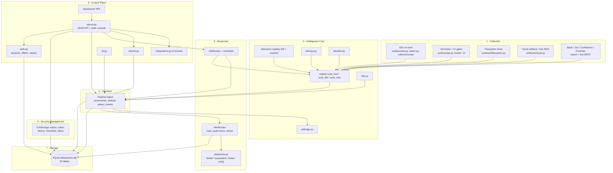
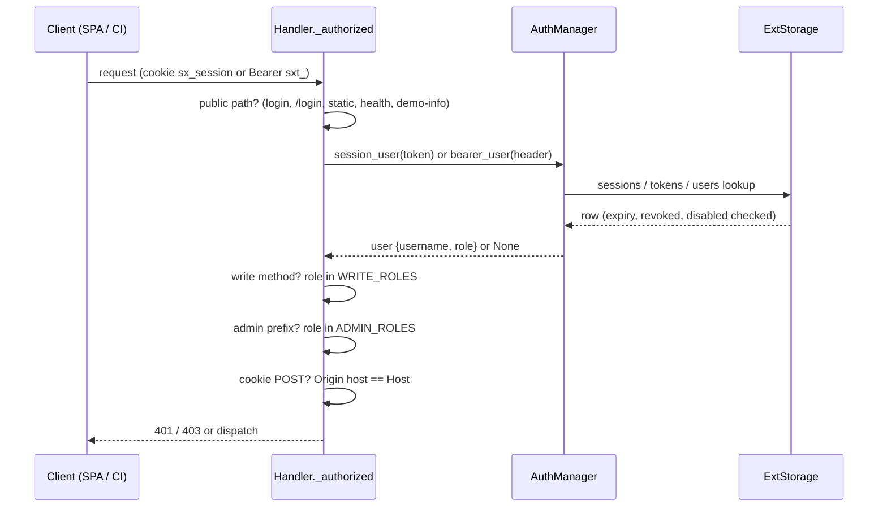

# SENTRIX Architecture

SENTRIX is a **modular monolith**: one Python process, one SQLite database, strict internal module boundaries. This document describes the structure as implemented in the `sentrix/` package.

## Why a modular monolith

- **Zero-dependency deployment.** The platform installs and runs anywhere Python 3.11+ exists — a workstation, a Kali laptop, an air-gapped server — with no message broker, no ORM, no container orchestration.
- **One consistent transaction boundary.** Finding ingestion, dedupe, occurrence counting, status history and event recording happen against a single store; there is no distributed consistency problem to solve.
- **Enforced internal interfaces.** Layers interact through shared dataclasses (`Finding`, `Event`, `Alert`, `Remediation`) and a small set of collaborator objects (`Storage`/`ExtStorage`, `Pipeline`, `AlertRouter`, `JobRunner`, `AuthManager`). Each collaborator is constructed once in `AppState` and injected, which is what makes future extraction feasible.
- **Honest scale.** SQLite with thread-local connections and a write lock comfortably serves a team-scale console. The single-node limit is documented, not hidden ([ROADMAP.md](ROADMAP.md)).

## Layer diagram

## Component interfaces

| Interface | Contract |
| --- | --- |
| `engine.scan_text(text, path, surface, allowlist) -> list[Finding]` | Pure detection: no storage, no network. Applies registry, entropy, validators, allowlist; returns masked, fingerprinted findings with `meta` (family, confidence, validation, environment, remediation) |
| `engine.scan_file / scan_tree` | File hygiene (size cap, binary skip, ignore rules) around `scan_text` |
| `Pipeline.ingest(findings, kind, owner, provenance) -> {"new": [...], "known": [...]}` | The only write path for detections: allowlist re-check, provenance + risk stamping, dedupe upsert, event record, SaaS triage branch, alert trigger, auto-ticket |
| `Storage / ExtStorage` | All SQL lives here. `upsert_finding` returns True only for new findings; `set_status` records history; every mutation takes the write lock |
| `AlertRouter.send(finding) -> list[Alert]` | Dedupe window, mute check, channel rules, quiet hours, delivery with retries; persists every alert row |
| `playbooks.execute(action, finding, cfg, storage) -> str` | Performs one response action, updates status where appropriate, records a `Remediation` row, returns a human-readable detail |
| `JobRunner.submit(path, surface, by) -> job_id` | Queues a background scan; runner owns cache reuse and status transitions |
| `AuthManager` | `login / session_user / bearer_user / add_user / set_role / create_token / audit / log`; the server asks it on every request |
| `integrations.inventory(cfg, storage, demo) -> list[dict]` | Read-only projection of provider state; never contacts providers |
| `reports.generate(type, format, storage, user) -> dict` | Read-only aggregation; persists body + metadata into `report_history` |
| Surface adapters | `scan_export(path)` / `live_scan(cfg)` / `scan_*(...) -> list[Finding]`; extraction only, detection delegated to the engine |

## Concurrency model

The server is `http.server.ThreadingHTTPServer`: one thread per request, plus daemon threads for jobs and the scheduler. SQLite is made safe by three mechanisms in `sentrix/core/storage.py` and `jobs.py`:

1. **Thread-local connections.** `Storage._db` lazily opens one `sqlite3` connection per thread (`check_same_thread=False`, `timeout=10`, `Row` factory). Cursors never interleave across request threads on a shared connection. All connections are tracked in a registry so `close()` can shut every one of them down (used by restore and server shutdown).
2. **Global write lock.** A single `threading.Lock` serializes all mutations (inserts, updates, purges, backups). Reads run concurrently on per-thread connections; SQLite's own locking plus the 10-second busy timeout handles file-level contention.
3. **Job semaphore.** `JobRunner` holds a `threading.Semaphore(2)`: at most two scans run concurrently; further submissions stay `queued` until a slot frees. Cancellation is cooperative — the cancelled-id set is checked before start and between files.

The scheduler is one daemon loop ticking every 10 seconds: due schedules -> job submission; SLA escalation for stale `open` findings; heuristic triage sweep for untriaged open findings. It exits cleanly on the stop event (server shutdown) or a closed-store `ProgrammingError`.

There is no async code, no shared mutable global state beyond the detector registry and engine tuning (both replaced atomically via `engine.configure`), and no background work that outlives the process.

## Migration and compatibility strategy

Schema evolution is additive and idempotent, executed in `ExtStorage.__init__` on every open:

| Mechanism | Behavior |
| --- | --- |
| **Legacy database rename** | If `data/sentrix.db` does not exist, the first existing legacy file in the same directory — `wintermute.db`, then `keysentry.db` — is renamed to `sentrix.db` (atomic `Path.replace`). All data is preserved; covered by `tests/test_sentrix.py::test_legacy_database_migrates` |
| **Base + extension schemas** | `CREATE TABLE IF NOT EXISTS` for the 5 core and 18 extension tables; opening an old file simply adds what is missing |
| **Column additions** | `ALTER TABLE ... ADD COLUMN` wrapped in `try/except OperationalError` for `users.title` and the six structured `system_log` columns (`component`, `event_type`, `exec_id`, `resource`, `status`, `correlation_id`) — safe to re-run |
| **Role migration** | `UPDATE users SET role='super_admin' WHERE role='admin'` and `role='security_analyst' WHERE role='analyst'` on every open; legacy three-role accounts keep working under the eight-role model |
| **Status superset** | The twelve-value `STATUSES` tuple is a superset of the original four (`open`, `triaged`, `remediated`, `false_positive`); existing rows remain valid, new lifecycle states are additive |
| **Migration ledger** | `migrations` rows for versions 2 and 3 are inserted with `INSERT OR IGNORE`, recording that the extension schema and structured-log upgrades were applied |
| **Brand strings** | Package, CLI, cookie (`sx_session`), token prefix (`sxt_`), environment variables (`SENTRIX_*`) and UI strings use the SENTRIX identity; legacy names survive only in the migration path itself |

Compatibility rules for contributors: never drop or rename a column in place; add columns with defaults, backfill with idempotent statements, and record a migration version. Old databases must open cleanly in the new code, and dumps from `GET /api/ops/dump` must import into a fresh store.

## Request authorization flow

## Boundaries for future service extraction

The monolith is deliberately seam-ready. Candidate extraction boundaries, in order of least coupling:

1. **Collection workers** — surface adapters and `JobRunner` already communicate through `Pipeline.ingest` and the jobs table; a distributed worker would poll `scan_jobs` and call the same ingest path (see ROADMAP).
2. **Alert delivery** — `AlertRouter` is injected into the pipeline; an outbox-worker service could consume the `alerts` table and own retries/delivery without touching detection.
3. **Connectors** — `surfaces/*` are pure functions returning findings; each could become an independent poller posting to `POST /api/scan`-style ingestion endpoints with a Bearer token.
4. **Reporting** — `reports.generate` only reads storage; it can move to a read replica or a separate process once PostgreSQL exists.
5. **Auth** — `AuthManager` is the single authority; replacing it with an OIDC provider requires implementing the same `session_user`/`bearer_user` contract.

The storage layer is the hard boundary: everything currently assumes one SQLite file. PostgreSQL support (ROADMAP) means re-implementing `Storage`/`ExtStorage` behind the same method surface, not changing callers.