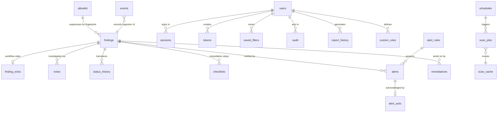

# SENTRIX Database

SENTRIX persists everything in one SQLite file, `data/sentrix.db` by default (`[storage] path`). The schema is created idempotently on every open by `sentrix/core/storage.py` (5 core tables) and `sentrix/core/extensions.py` (18 extension tables) — **23 tables** total. Timestamps are ISO-8601 UTC text (`YYYY-MM-DDTHH:MM:SS`); JSON documents are stored as TEXT. `sql/schema.sql` mirrors the core DDL for reference.

## Table catalog

### Detection core

| Table | Columns | Purpose |
| --- | --- | --- |
| `findings` | `id` TEXT PK, `detector_id`, `title`, `severity`, `surface`, `path`, `line` INTEGER, `secret_masked`, `entropy` REAL, `fingerprint`, `status`, `owner`, `created_at`, `updated_at`, `meta` (JSON) | One row per unique exposure. `id` = first 12 hex of SHA-256 of `fingerprint\|path\|line`. `meta` carries family, remediation key, confidence, validation, environment, origin/provenance, risk, triage, demo flag. Raw secrets are never stored |
| `events` | `id` TEXT PK, `kind`, `surface`, `payload` (JSON), `ts` | Pipeline event journal: `scan.cli`, `scan.job`, `scan.path`, `demo.seeded`, `gate.blocked/passed`, `ingest.<surface>`, `integration.sync`, `watch.changed`, `selftest` |
| `alerts` | `id` TEXT PK, `finding_id`, `channel`, `message`, `status`, `ts` | Every delivery attempt per channel; status `sent`, `deferred-quiet-hours`, `dry-run`, `http-<code>`, `failed: ...` |
| `allowlist` | `fingerprint` TEXT PK, `reason`, `created_at` | False-positive registry keyed by SHA-256 fingerprint of `detector_id\|secret`; applies across all surfaces |
| `remediations` | `id` TEXT PK, `finding_id`, `action`, `detail`, `ts` | Response action log: rotate-guide, redact, quarantine, restore, ticket, auto-ticket, verify |

### Identity and access

| Table | Columns | Purpose |
| --- | --- | --- |
| `users` | `username` TEXT PK, `pw_hash`, `salt`, `role`, `disabled` INTEGER DEFAULT 0, `created_at`, `title` TEXT DEFAULT '' | Local accounts. PBKDF2-HMAC-SHA256 (200k iterations) hash + per-user salt; one of eight roles; `title` added by migration |
| `sessions` | `token` TEXT PK, `username`, `role`, `expires_at` REAL | Server-side sessions (epoch expiry). Expired rows purged at each login; cookie holds the token |
| `tokens` | `id` TEXT PK, `name`, `token_hash`, `role`, `created_by`, `created_at`, `revoked` INTEGER DEFAULT 0 | API tokens; only the SHA-256 hash of the `sxt_...` value is stored |

### Audit and logging

| Table | Columns | Purpose |
| --- | --- | --- |
| `audit` | `id` INTEGER PK AUTOINCREMENT, `ts`, `username`, `action`, `detail` | Append-only security trail: logins, user/token changes, bulk actions, ops, exceptions, tuning, integration controls |
| `system_log` | `id` INTEGER PK AUTOINCREMENT, `ts`, `level`, `source`, `message`, plus structured columns `component`, `event_type`, `exec_id`, `resource`, `status`, `correlation_id` (all TEXT DEFAULT '') | Live system journal. The six structured columns were added by idempotent `ALTER TABLE` migrations; `component` defaults to `source` when not supplied |

### Finding management

| Table | Columns | Purpose |
| --- | --- | --- |
| `finding_extra` | `finding_id` TEXT PK, `assignee` DEFAULT '', `tags` JSON DEFAULT '[]', `severity_override` DEFAULT '', `pinned` INTEGER DEFAULT 0, `muted` INTEGER DEFAULT 0, `occurrences` INTEGER DEFAULT 1, `first_seen`, `last_seen` | Workflow state per finding; occurrences increment on every duplicate sighting |
| `notes` | `id` INTEGER PK AUTOINCREMENT, `finding_id`, `username`, `body`, `ts` | Investigation notes |
| `status_history` | `id` INTEGER PK AUTOINCREMENT, `finding_id`, `old`, `new`, `username`, `ts` | Every lifecycle transition with actor; written only when the status actually changes |
| `checklists` | `id` INTEGER PK AUTOINCREMENT, `finding_id`, `step_idx`, `done` INTEGER DEFAULT 0, `username`, `ts`, UNIQUE(`finding_id`,`step_idx`) | Five-step remediation checklist per finding |
| `saved_filters` | `id` TEXT PK, `username`, `name`, `params` (JSON), `ts` | Per-user saved finding filters |

### Scanning operations

| Table | Columns | Purpose |
| --- | --- | --- |
| `scan_jobs` | `id` TEXT PK, `path`, `surface`, `status`, `triggered_by`, `started`, `finished`, `files` INTEGER DEFAULT 0, `findings` INTEGER DEFAULT 0, `error` TEXT DEFAULT '' | Background job history; statuses `queued`, `running`, `done`, `cancelled`, `failed` |
| `scan_cache` | `path` TEXT PK, `mtime` REAL, `size` INTEGER, `findings` (JSON), `scanned_at` | Incremental scan cache: unchanged mtime+size reuses stored findings instead of re-scanning |
| `schedules` | `id` TEXT PK, `path`, `surface`, `interval_seconds` INTEGER, `enabled` INTEGER DEFAULT 1, `last_run` REAL DEFAULT 0 | Recurring scans; due when `last_run + interval_seconds <= now` |

### Alerting

| Table | Columns | Purpose |
| --- | --- | --- |
| `alert_rules` | `id` TEXT PK, `channel`, `min_severity`, `enabled` INTEGER DEFAULT 1 | Per-channel minimum severity; first enabled rule for a channel wins |
| `alert_acks` | `alert_id` TEXT PK, `username`, `ts` | Alert acknowledgements |

### Platform

| Table | Columns | Purpose |
| --- | --- | --- |
| `migrations` | `version` INTEGER PK, `applied_at` | Schema ledger; versions 2 (extension schema) and 3 (structured logs / role map) recorded with `INSERT OR IGNORE` |
| `report_history` | `id` TEXT PK, `type`, `format`, `created_by`, `rows` INTEGER, `created_at`, `body` TEXT | Generated reports with their full body for later download (list shows latest 100) |
| `custom_rules` | `id` TEXT PK, `title`, `severity`, `pattern`, `created_by`, `created_at`, `enabled` INTEGER DEFAULT 1 | Runtime-created custom detectors (persisted; see restart note in [DETECTION_ENGINE.md](DETECTION_ENGINE.md)) |

## Entity relationships

Foreign keys are logical (SQLite constraints are not declared between these tables); integrity is maintained by the storage layer, and retention purge deletes child rows explicitly.

## Indexes

| Index | Table | Purpose |
| --- | --- | --- |
| `idx_findings_status` | `findings(status)` | Lifecycle filters and escalation sweeps |
| `idx_findings_fingerprint` | `findings(fingerprint)` | Dedupe lookup and related-findings queries |
| implicit PK indexes | all tables | Primary-key lookups |
| implicit UNIQUE index | `checklists(finding_id, step_idx)` | One row per step |

Ordering elsewhere uses `created_at DESC, id` (findings), `ts DESC, id DESC` (events/alerts), `id DESC` (audit/logs) and `rowid` (schedules/rules).

## Concurrency and durability

- One connection per thread (`thread-local`), `timeout=10`, `check_same_thread=False`; a global `threading.Lock` serializes writes. See [ARCHITECTURE.md](ARCHITECTURE.md).
- Every mutation commits immediately; there are no long transactions.
- `close()` shuts down all tracked connections (used by restore and shutdown).

## Retention

`POST /api/ops/purge {"days": N}` (admin) or `ExtStorage.purge_retention`:

1. Selects findings with status `remediated` or `false_positive` whose `updated_at` is older than the cutoff (default 90 days).
2. Deletes their `notes`, `status_history`, `finding_extra`, `checklists` rows, then the findings.
3. Deletes `system_log` rows older than the cutoff.

Notes: `verified`/`closed` findings are **not** purged by this routine (they are kept as evidence); events, alerts, audit and report history are not age-purged. Run `POST /api/ops/vacuum` afterwards to reclaim file space.

## Backup and recovery

| Operation | Mechanism |
| --- | --- |
| Online backup | `POST /api/ops/backup` or `python run.py backup --dest PATH` — uses the SQLite online backup API (`Connection.backup`) into `data/backups/sentrix-<epoch>.db`; safe while the server runs |
| Restore | `POST /api/ops/restore {"path": "..."}` (admin) — closes the store, copies the backup over `storage.path`, reopens and rewires pipeline/auth. Take a fresh backup first if the current state matters |
| Logical dump | `GET /api/ops/dump` — JSON of 10 tables: findings, events, alerts, allowlist, remediations, notes, finding_extra, saved_filters, schedules, alert_rules |
| Logical import | `POST /api/ops/import` (admin) — `INSERT OR REPLACE` into the same whitelisted tables; returns row count |
| File-level copy | Stop the server, copy `data/sentrix.db` (and the `data/` tree for outbox/quarantine/guides) |

The JSON dump deliberately excludes identity and audit tables (users, sessions, tokens, audit, system_log, report bodies). For a complete, faithful backup use the SQLite backup — it captures all 23 tables. The database contains password hashes, session tokens and token hashes: protect backups like a credential store.

## Legacy compatibility and migrations

On open, `ExtStorage`:

1. Renames a legacy `wintermute.db` or `keysentry.db` (in that order) to `sentrix.db` when the target does not exist — data preserved.
2. Creates missing tables; adds `users.title` and the six `system_log` structured columns via tolerated `ALTER TABLE`.
3. Maps legacy roles: `admin` -> `super_admin`, `analyst` -> `security_analyst`.
4. Records migration versions 2 and 3.

The twelve-status lifecycle is a superset of the original four statuses, so old rows remain valid without conversion.

## PostgreSQL migration strategy (not implemented)

The storage layer is the designated seam: all SQL is confined to `Storage`/`ExtStorage`, and callers use method contracts only. A PostgreSQL backend would:

1. Re-implement those methods behind the same interface (psycopg or equivalent), keeping the write-lock semantics via transactions/row locks.
2. Convert `INSERT OR REPLACE` to `ON CONFLICT ... DO UPDATE`, AUTOINCREMENT to identity columns, and JSON TEXT columns to `jsonb`.
3. Replace the `migrations` ledger with forward-only numbered scripts.
4. Keep SQLite as the offline/edge mode; the choice would be a `[storage]` config switch.

This is roadmap work — see [ROADMAP.md](ROADMAP.md). Nothing in the current release connects to PostgreSQL.