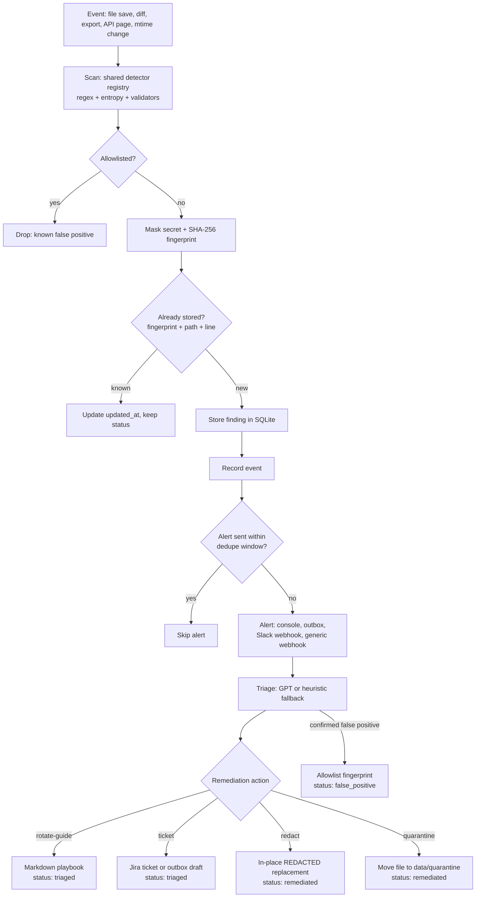
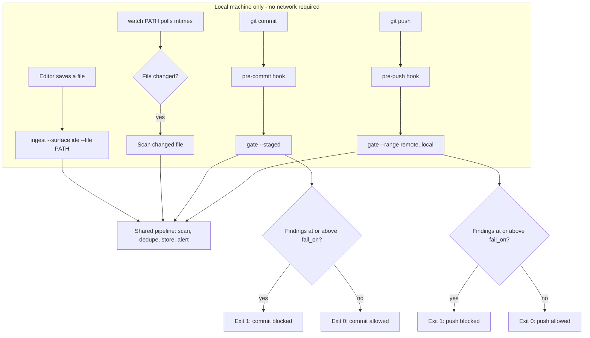
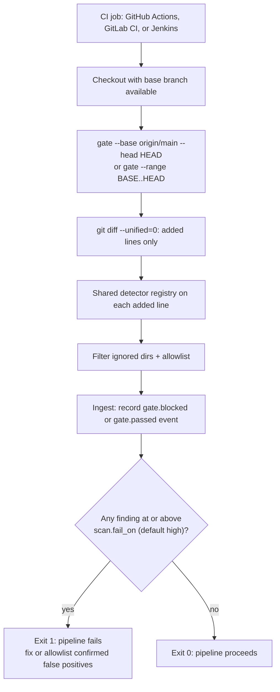
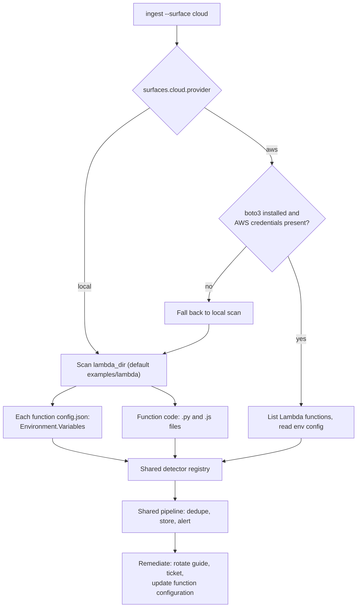
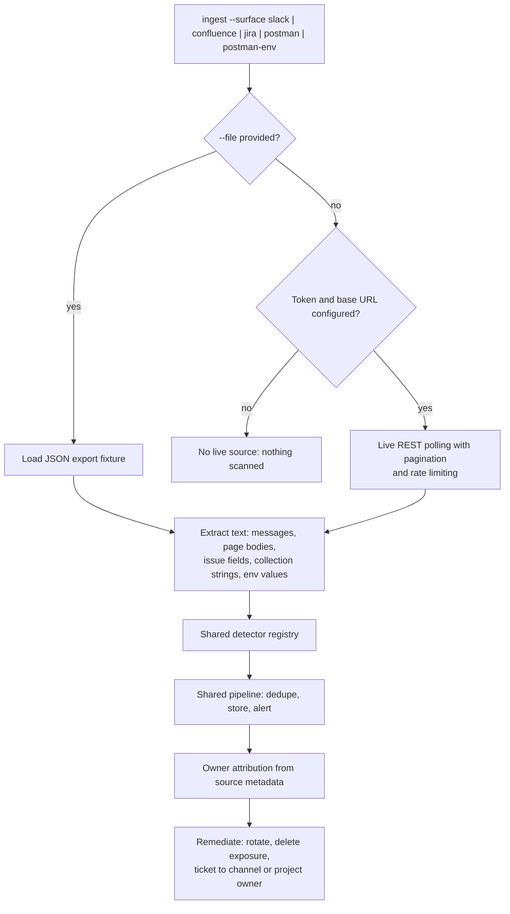
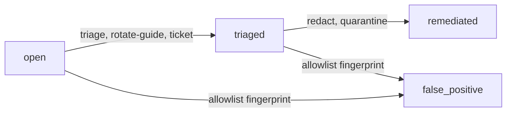

# Flowcharts

All layers converge on the same pipeline: **event → scan → alert → remediation**. Diagrams use [Mermaid](https://mermaid.js.org/) syntax and render on most modern markdown viewers.

## Unified flow

## Layer 1: local development (IDE, watch, git hooks)

## Layer 2: CI diff gate

## Layer 3: cloud / Lambda

## Layer 4: SaaS monitoring (Slack, Confluence, Jira, Postman)

## Status lifecycle

