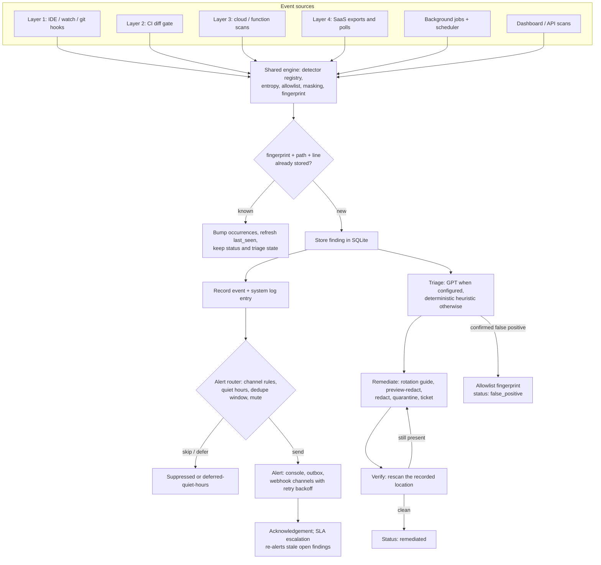

# KeySentry Overview

KeySentry v1.1.0 — a layered secret-detection system that follows one unified flow, **event → scan → alert → remediation**, from the editor to the cloud. One shared detector registry powers every layer; findings are masked, fingerprinted, deduplicated, and managed through an authenticated graphite dashboard. Python 3.11+ standard library only; everything works offline.

This document is the centerpiece: purpose, layers, pipeline, module map, request/auth flow, storage, logging, design principles, and the full catalog of **100 features in v1.1**.

Related docs: [Architecture](ARCHITECTURE.md) · [API](API.md) · [Install](INSTALL.md) · [Detectors](DETECTORS.md) · [Surfaces](SURFACES.md) · [Remediation](REMEDIATION.md) · [Privacy](PRIVACY.md) · [Flowcharts](FLOWCHART.md) · [Security policy](../SECURITY.md) · [Changelog](../CHANGELOG.md)

## Purpose

Secrets leak through many doors: an editor save, a commit, a CI diff, a cloud function's environment, a chat message, a wiki page, an API collection. KeySentry closes the loop on all of them with a single system:

1. **Detect** the same credential formats everywhere, using one registry of regex + entropy + validator detectors.
2. **Store safely** — only a masked preview and a SHA-256 fingerprint; raw secrets are never persisted.
3. **Notify** through rule-governed channels with dedupe, quiet hours, retries, acknowledgement, and escalation.
4. **Remediate** with rotation guides, previewable redaction, quarantine/restore, ticketing, and verification rescans.
5. **Operate** with users and roles, audit and live logs, background jobs, schedules, backups, exports, and metrics.

## The four detection layers

| # | Layer | What it covers | How it is triggered |
| --- | --- | --- | --- |
| 1 | Local development | IDE on-save checks, filesystem watching, pre-commit/pre-push git hooks — fully local, no network | `ingest --surface ide --file PATH`, `watch PATH`, `hooks install` |
| 2 | CI diff gate | Added lines of a pull/merge diff; non-zero exit blocks the pipeline | `gate --base origin/main --head HEAD` (or `--range`, `--staged`) |
| 3 | Cloud / serverless | Function code and environment variables, from local exports or live provider scans | `ingest --surface cloud` (optional `boto3` for live mode) |
| 4 | SaaS monitoring | Chat, wiki, ticketing, and API-collection exports or live reads (`slack`, `confluence`, `jira`, `postman` surfaces) | `ingest --surface ... --file export.json`, or live mode with tokens |

Every layer produces the same `Finding` object and feeds the same pipeline. In v1.1 the dashboard adds two more event sources on top: background scan jobs and scheduled scans.

## Unified pipeline

Only **new** findings alert; re-detections update counters. Every stage writes a system log entry, visible live in the Logs view.

## Module map

Every `keysentry` submodule and its one-line responsibility.

| Module | Responsibility |
| --- | --- |
| `keysentry/__init__.py` | Package version and product-name constants |
| `keysentry/__main__.py` | `python -m keysentry` entry point, delegates to the CLI |
| `keysentry/cli.py` | One command line for every layer: serve, scan, gate, hooks, demo, selftest, report, watch, surfaces, allowlist, triage, remediate, ingest |
| `keysentry/config.py` | Layered config: defaults < `config.toml` < `config.local.toml` < environment (secrets via `*_env` indirection) |
| `keysentry/server.py` | Stdlib threading HTTP server: login page, static dashboard, authenticated JSON API, security headers |
| `keysentry/auth.py` | Password hashing, sessions, RBAC, API tokens, login rate limiting, audit and system-log writers |
| `keysentry/watch.py` | Polling filesystem watcher: mtime comparison, scan-on-change, pipeline ingest |
| `keysentry/demo.py` | Synthetic demo findings across all surfaces for first-run exploration |
| `keysentry/core/__init__.py` | Core package marker |
| `keysentry/core/models.py` | Shared dataclasses (`Finding`, `Event`, `Alert`, `Remediation`) and severity/status enums |
| `keysentry/core/engine.py` | Scanning engine: `scan_text`/`scan_file`/`scan_tree`/`walk_files`; applies tuning, custom detectors, allowlist, masking, entropy, fingerprints |
| `keysentry/core/pipeline.py` | Unified ingest: allowlist re-check, dedupe upsert, event recording, alert routing for new findings |
| `keysentry/core/storage.py` | v1 SQLite persistence: findings, events, alerts, allowlist, remediations; thread-safe writes |
| `keysentry/core/extensions.py` | v2 extended storage: users, sessions, tokens, audit, logs, finding management, jobs, schedules, rules, checklists, ops |
| `keysentry/core/jobs.py` | Background `JobRunner` (incremental cache, cancel, concurrency cap) plus the scheduler/escalation loop |
| `keysentry/core/allowlist.py` | False-positive registry: built-in safe values/patterns, config regexes, fingerprint suppression |
| `keysentry/core/entropy.py` | Shannon entropy scoring (`shannon`, `looks_random`) |
| `keysentry/core/util.py` | Masking (`mask_secret`), fingerprinting, severity comparison (`at_least`) |
| `keysentry/detectors/__init__.py` | Imports all pattern modules so registration runs at startup; re-exports the registry |
| `keysentry/detectors/base.py` | `Detector` dataclass, `REGISTRY`, `register`, `all_detectors` |
| `keysentry/detectors/cloud.py` | Cloud provider access keys, secrets, and connection strings |
| `keysentry/detectors/saas.py` | SaaS and developer-platform tokens and webhooks |
| `keysentry/detectors/crypto.py` | Private key material, JWTs, credential-bearing URLs and URIs |
| `keysentry/detectors/generic.py` | Generic secret assignments, high-entropy strings, environment-file secrets |
| `keysentry/surfaces/__init__.py` | Surface adapter registry (`SURFACE_MODULES`) |
| `keysentry/surfaces/common.py` | Shared REST, pagination, and rate-limit helpers for live adapters |
| `keysentry/surfaces/filesystem.py` | File/tree scanning adapter |
| `keysentry/surfaces/git.py` | Diff-only gate adapter: staged changes or commit ranges, added lines mapped to real positions |
| `keysentry/surfaces/ide.py` | Editor on-save adapter |
| `keysentry/surfaces/slack.py` | Chat export and live message scanning |
| `keysentry/surfaces/confluence.py` | Wiki page export and live scanning |
| `keysentry/surfaces/jira.py` | Issue scanning and security ticket creation |
| `keysentry/surfaces/postman.py` | API collection and environment export scanning |
| `keysentry/surfaces/cloud.py` | Function code + environment scanning, local exports or live provider mode |
| `keysentry/alerting/__init__.py` | Alerting package marker |
| `keysentry/alerting/router.py` | Channel routing with rules, quiet hours, dedupe, mute, retry backoff, dry-run, outbox |
| `keysentry/remediation/__init__.py` | Remediation package marker |
| `keysentry/remediation/playbooks.py` | Rotation guides per family; redact, preview-redact, quarantine, restore, ticket, verify actions |
| `keysentry/ai/__init__.py` | Optional triage package marker |
| `keysentry/ai/gpt.py` | Stdlib client for GPT-compatible chat endpoints |
| `keysentry/ai/prompts.py` | Masked-only prompt construction |
| `keysentry/ai/triage.py` | GPT triage with deterministic heuristic fallback |
| `keysentry/dashboard/index.html` | Single-page graphite dashboard shell: views, drawer, palette, dialogs |
| `keysentry/dashboard/login.html` | Login page |
| `keysentry/dashboard/app.js` | View logic, live polling, command palette, keyboard shortcuts, bulk bar, toasts |
| `keysentry/dashboard/styles.css` | Minimalist monochrome graphite theme, responsive mobile cards |

## Request and auth flow

The server binds to `127.0.0.1:8710` by default. Every request passes the same gate:

1. **Public paths** need no identity: `GET /`, `/login`, `/favicon.svg`, `/logo.svg`, `/api/health`, anything under `/static/`, and `POST /api/auth/login`.
2. **Identity resolution** for everything else: the `ks_session` cookie is looked up in the `sessions` table (expiry and account-disabled checks on every request); failing that, an `Authorization: Bearer kst_...` header is matched against stored SHA-256 token hashes (revocation checked). No identity → `401`.
3. **Role enforcement**: `viewer` is read-only — all `POST`/`DELETE` are rejected with `403` except logout and own password change. Admin-only prefixes (`/api/users`, `/api/tokens`, `/api/ops/restore`, `/api/ops/import`, `/api/ops/purge`) require `admin`; anyone else gets `403`. `analyst` can use everything else, including scans, jobs, findings management, alerts, remediation, backup, and exports.
4. **Login** verifies PBKDF2-HMAC-SHA256 (200,000 iterations, per-user salt) with constant-time comparison, under a per-IP rate limit (default 5 attempts per rolling 60-second window). Success issues a random session token as an `HttpOnly; SameSite=Strict` cookie with a 12-hour default lifetime.
5. **Logging**: every mutation `POST` (except login) is written to `system_log` with the actor and path; security-relevant actions additionally land in the `audit` table.
6. **Response headers**: every response carries `Cache-Control: no-store`, `X-Content-Type-Options: nosniff`, `X-Frame-Options: DENY`, and `Referrer-Policy: no-referrer`.

First run: if no users exist, an `admin` account is created. Its password comes from `KEYSENTRY_ADMIN_PASSWORD` when set, otherwise a random value; either way it is written to `data/INITIAL_ADMIN_PASSWORD.txt`. Change it in Settings after first login.

## Storage schema summary

One SQLite database at `data/keysentry.db` (configurable via `storage.path`). All timestamps are UTC ISO strings. Schema v1 is created by `core/storage.py`; `core/extensions.py` adds the v2 tables and records version 2 in `migrations`.

### v1 tables (detection core)

| Table | Key columns | Notes |
| --- | --- | --- |
| `findings` | `id` (PK), `detector_id`, `title`, `severity`, `surface`, `path`, `line`, `secret_masked`, `entropy`, `fingerprint`, `status`, `owner`, `created_at`, `updated_at`, `meta` (JSON) | Indexed on `status` and `fingerprint`; dedupe key is `(fingerprint, path, line)` |
| `events` | `id` (PK), `kind`, `surface`, `payload` (JSON), `ts` | One row per ingest batch (scans, gates, jobs, demo) |
| `alerts` | `id` (PK), `finding_id`, `channel`, `message`, `status`, `ts` | `sent`, `dry-run`, `deferred-quiet-hours`, `http-<code>`, `failed: ...` |
| `allowlist` | `fingerprint` (PK), `reason`, `created_at` | False-positive registry shared by every layer |
| `remediations` | `id` (PK), `finding_id`, `action`, `detail`, `ts` | One row per executed action |

### v2 tables (v1.1 extensions)

| Table | Key columns | Notes |
| --- | --- | --- |
| `users` | `username` (PK), `pw_hash`, `salt`, `role`, `disabled`, `created_at` | PBKDF2 hashes; roles admin/analyst/viewer |
| `sessions` | `token` (PK), `username`, `role`, `expires_at` | Expired rows purged on login |
| `tokens` | `id` (PK), `name`, `token_hash`, `role`, `created_by`, `created_at`, `revoked` | Only SHA-256 hashes stored; raw `kst_` value shown once |
| `audit` | `id`, `ts`, `username`, `action`, `detail` | Security-relevant actions |
| `system_log` | `id`, `ts`, `level`, `source`, `message` | Operational log, live-tailed by the Logs view |
| `notes` | `id`, `finding_id`, `username`, `body`, `ts` | Per-finding discussion |
| `finding_extra` | `finding_id` (PK), `assignee`, `tags` (JSON), `severity_override`, `pinned`, `muted`, `occurrences`, `first_seen`, `last_seen` | Management metadata alongside each finding |
| `status_history` | `id`, `finding_id`, `old`, `new`, `username`, `ts` | Every status transition |
| `saved_filters` | `id` (PK), `username`, `name`, `params` (JSON), `ts` | Per-user filter presets |
| `schedules` | `id` (PK), `path`, `surface`, `interval_seconds`, `enabled`, `last_run` | Recurring scans |
| `scan_jobs` | `id` (PK), `path`, `surface`, `status`, `triggered_by`, `started`, `finished`, `files`, `findings`, `error` | queued/running/done/cancelled/failed |
| `scan_cache` | `path` (PK), `mtime`, `size`, `findings` (JSON), `scanned_at` | Incremental re-scan cache |
| `alert_rules` | `id` (PK), `channel`, `min_severity`, `enabled` | Per-channel severity gates |
| `alert_acks` | `alert_id` (PK), `username`, `ts` | Acknowledgements |
| `checklists` | `id`, `finding_id`, `step_idx`, `done`, `username`, `ts` | Persisted remediation checklist steps, unique per (finding, step) |
| `migrations` | `version` (PK), `applied_at` | Schema version marker (2) |

Identity rules are unchanged: fingerprint = `SHA-256(detector_id + "|" + secret)`; finding id = first 12 hex chars of `SHA-256(fingerprint + "|" + path + "|" + line)`.

## Where logs come from

Two streams, both in SQLite, both visible in the dashboard:

- **`system_log`** — operational events, written through `AuthManager.log` by:
  - `auth`: sign-ins, password changes, initial admin creation, rate-limit warnings
  - `http`: every mutation `POST` except login (actor + path)
  - `scan`: playground and path scans, job start/finish summaries
  - `jobs`: queued, cancelled, and failed jobs
  - `scheduler`: schedule triggers and loop errors
  - `escalation`: SLA re-alerts for stale open findings
  - `remediation`: executed actions
  - `demo`: demo seeding
  Levels are `info`, `warn`, `error`. The Logs view polls `GET /api/logs`, supports level filtering, and can pause the live stream.
- **`audit`** — security-relevant actions only: `login.ok`, `login.failed`, `logout`, `password.changed`, `user.added`, `user.role`, `user.disabled`, `user.enabled`, `token.created`, `token.revoked`, `bulk.*`, `ops.backup`, `ops.restore`, `ops.purge`, `ops.import`, `detectors.tuning`. Each row carries actor, action, detail, and timestamp; browse via `GET /api/audit`.

## Design principles

- **Stdlib-only.** Python 3.11+ standard library at runtime: `sqlite3`, `http.server`, `urllib`, `tomllib`, `hashlib`, `secrets`, `threading`. The only optional third-party package is `boto3` for live cloud scans.
- **Masking instead of storage.** Raw secrets live only in memory long enough to validate, fingerprint, and mask. Database rows, alerts, tickets, exports, and AI prompts carry the masked preview plus fingerprint — never the value.
- **One pattern set, many layers.** Detectors register once; surfaces are thin adapters. A pattern fix or severity tune improves IDE, CI, cloud, and SaaS detection simultaneously, and allowlist decisions apply everywhere.
- **Offline-first.** Console and outbox alerting, heuristic triage, local exports, and the full dashboard work with no network. Unconfigured webhook channels record `dry-run` alerts instead of calling out.
- **Minimalist graphite UI.** A single monochrome graphite theme: no theme switcher, no decoration that competes with the data. Login gate, per-section help popovers, pipeline Overview, live Logs, command palette, and keyboard shortcuts keep operators fast.
- **Fail closed, log everything.** Unauthenticated requests get `401`; role violations get `403`; every mutation is logged and security-relevant actions are audited.

## Feature catalog

Exactly **100 features in v1.1**, numbered continuously across nine groups.

### Authentication & access (12)

1. **Login page** — dedicated sign-in screen gating the dashboard and API.
2. **HttpOnly SameSite session cookies** — `ks_session` cookie, `SameSite=Strict`, script-inaccessible, 12-hour default expiry.
3. **PBKDF2 password hashing** — PBKDF2-HMAC-SHA256 with 200,000 iterations and a random per-user salt.
4. **Login rate limiting** — default 5 attempts per IP per rolling 60-second window, configurable.
5. **Three-role RBAC** — admin, analyst, and viewer roles enforced server-side on every request.
6. **Viewer read-only enforcement** — viewers browse freely; all mutations are rejected except logout and own password change.
7. **Admin-only areas** — user management, API tokens, restore, import, and retention purge require the admin role.
8. **Password change** — self-service change requiring the current password; new passwords must be at least 10 characters.
9. **User management** — admins create accounts with a role and list them in Settings.
10. **Account disable** — admins disable or re-enable accounts; disabled users lose access immediately; self-disable is blocked.
11. **API token create/revoke** — named `kst_` tokens with a role; only SHA-256 hashes stored; raw value shown once; revocable at any time.
12. **Bearer auth for CI** — `Authorization: Bearer kst_...` authenticates scripts and CI gates without cookies.

### Transport security (4)

13. **nosniff header** — `X-Content-Type-Options: nosniff` on every response.
14. **Frame denial** — `X-Frame-Options: DENY` blocks embedding and clickjacking.
15. **Referrer policy** — `Referrer-Policy: no-referrer` keeps paths and query strings from leaking.
16. **no-store caching** — `Cache-Control: no-store` on every response so sensitive data never lingers in caches.

### Audit & logging (6)

17. **Audit trail** — append-only record of security-relevant actions with actor and detail.
18. **System log** — operational events from every subsystem, persisted in SQLite.
19. **Live log stream** — the Logs view tails new entries as they happen.
20. **Level filtering** — filter the log by `info`, `warn`, or `error`.
21. **Pause** — freeze the live stream to read without new entries pushing in.
22. **Mutation request logging** — every `POST` except login is logged with username and path.

### Finding management (18)

23. **Notes** — per-finding discussion entries with author and timestamp.
24. **Tags** — free-form labels for organizing findings.
25. **Assignee** — route a finding to a named owner.
26. **Severity override** — per-finding severity that supersedes the detector default.
27. **Pin** — pin critical items to the top via the pinned sort.
28. **Mute** — silence a finding's alerts without changing its status.
29. **Occurrence counting** — re-detections bump a counter instead of creating duplicates.
30. **First/last seen** — first detection and latest re-detection timestamps per finding.
31. **Status history** — every transition recorded with old value, new value, actor, and time.
32. **Related findings** — other locations sharing the same fingerprint, one click away.
33. **Bulk status** — set a status across many findings in one action.
34. **Bulk allowlist** — allowlist fingerprints and mark selected findings false-positive in one step.
35. **Bulk assign** — assign many findings at once.
36. **Bulk tag** — add a tag to many findings at once.
37. **Saved filters** — per-user named filter presets, persisted and restorable.
38. **Sorting** — order by created time, severity, occurrences, or pinned.
39. **Pagination** — page and page-size controls with total counts.
40. **Search** — substring search across title, path, and detector id, combined with filters.

### Scanning & scheduling (12)

41. **Background jobs** — tree scans run off the request thread; the Jobs view tracks progress.
42. **Job cancel** — cooperative cancellation, checked between files.
43. **Job history** — persisted queued/running/done/cancelled/failed records with file and finding counts.
44. **Incremental cache** — unchanged files (mtime + size) reuse cached results on re-scan.
45. **Concurrency cap** — at most two scan jobs run simultaneously.
46. **Schedule CRUD** — create, list, and delete recurring scans with path, surface, and interval.
47. **Schedule toggle** — enable or disable a schedule without deleting it.
48. **Scheduler loop** — a background tick every 10 seconds fires due schedules.
49. **Custom detectors** — config-defined regex detectors registered at startup.
50. **Detector disable** — turn off any detector by id via config or API.
51. **Severity tuning** — per-detector severity overrides via config or API.
52. **Playground** — scan ad-hoc text or a server path on demand.

### Alerting (10)

53. **Channel rules** — per-channel minimum-severity rules with an enable toggle.
54. **Quiet hours** — UTC window that defers network alerts, including overnight wrap-around.
55. **Retry backoff** — failed webhook posts retried up to three attempts with 1s/2s backoff.
56. **Acknowledgement** — ack alerts from the dashboard; actor and time recorded.
57. **Mute integration** — muted findings never generate alerts.
58. **Escalation** — findings still open past the SLA (default 24h) are re-alerted by the scheduler.
59. **Digest** — 24-hour summary endpoint: totals, open counts, severity breakdown, alerts sent.
60. **Dedupe window** — per-finding alert suppression window, default 3600 seconds.
61. **Dry-run** — unconfigured network channels record dry-run alerts instead of calling out.
62. **Outbox** — file-based channel writing alert JSON to `data/outbox` for offline review.

### Remediation (10)

63. **Rotation guides** — per-family markdown playbooks written to `data/remediation`.
64. **Redact** — in-place replacement of the secret with a `<REDACTED:detector>` marker.
65. **Redact preview** — before/after preview without touching the file.
66. **Quarantine** — move the exposing file to `data/quarantine`.
67. **Restore** — move a quarantined file back when the original path is free.
68. **Ticketing** — create a security ticket via the `jira` surface or write an outbox draft.
69. **Verification rescan** — rescan the recorded location; mark remediated only when clean.
70. **Checklists** — step-by-step remediation checklist in the finding drawer.
71. **Checklist persistence** — step completion stored per finding with actor and timestamp.
72. **Status transitions** — actions advance status (triaged/remediated) and every change is recorded in history.

### Operations & export (10)

73. **Backup** — online SQLite backup to `data/backups` with one call.
74. **Restore** — admin-only restore from a backup file; storage reopens live.
75. **Retention purge** — admin-only removal of resolved findings older than N days (default 90) plus their notes, history, checklists, and old log rows.
76. **Vacuum** — reclaim database space after purges.
77. **Dump export** — full JSON dump of the core data tables.
78. **Import** — admin-only JSON import into a whitelisted set of tables.
79. **CSV export** — findings as CSV for spreadsheets and reports.
80. **JSON export** — findings as JSON for downstream tooling.
81. **Metrics endpoint** — Prometheus-format gauges at `/api/metrics`.
82. **DB size stats** — database bytes plus job, schedule, and user counts at `/api/ops/stats`.

### Interface & UX (18)

83. **Graphite theme** — one minimalist monochrome theme across the whole dashboard.
84. **Modern favicon** — monochrome favicon matching the graphite identity.
85. **Help popovers** — per-section "?" help explaining each view in place.
86. **Pipeline overview** — the Overview view visualizes stage counts across the pipeline.
87. **How-it-works** — a plain-language walkthrough of the five pipeline stages.
88. **Command palette** — Ctrl+K palette for jumping to views and actions.
89. **Keyboard shortcuts** — keyboard navigation for views, lists, and the drawer.
90. **Drawer tabs** — finding detail split into focused tabs instead of one long panel.
91. **Bulk bar** — a selection toolbar surfacing bulk actions when findings are selected.
92. **Skeletons** — loading placeholders while data is in flight.
93. **Confirm dialogs** — destructive actions require explicit confirmation.
94. **Toasts** — non-blocking success and error notifications.
95. **Empty states** — helpful empty states with next-step hints.
96. **Mobile cards** — responsive card layout and bottom tab bar on small screens.
97. **User menu** — signed-in identity, role, password change, and logout in one menu.
98. **Relative time** — human-friendly relative timestamps throughout.
99. **Settings reorg** — Settings grouped into focused sections for account, access, detectors, schedules, rules, and ops.
100. **Login UX** — focused sign-in screen with clear credential errors and rate-limit feedback.